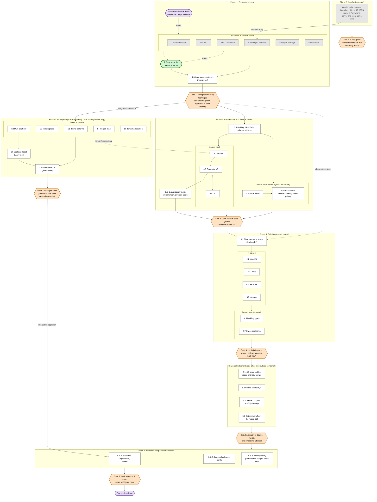
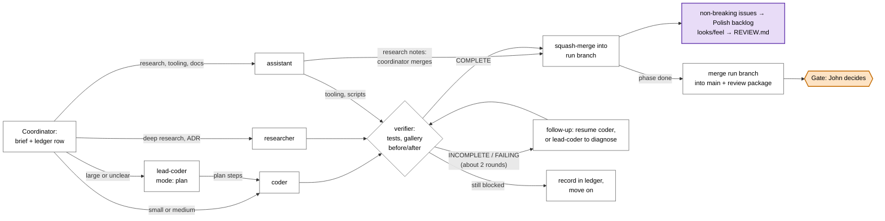

# Process overview

A one-page map of how the project moves from research to a release: the
phases, the parallel tracks inside each, what depends on what, and where John
decides. The detail lives in [ROADMAP.md](ROADMAP.md) (items, gates) and
[.claude/agents/](../.claude/agents/) (how agents run an item); this page only
connects them. Last updated 2026-10-14 (Phase 1, tracks 1–6 done).

Why a flowchart and not a Gantt chart: the roadmap has no dates or durations,
only order and dependencies. A Gantt chart would invent a schedule, and its
bars can't show "this waits for that gate" or "John's decision feeds back
here". The flowchart below shows exactly those.

## 1. Phases, tracks and gates

How to read it:
- **Boxes** are phases; nodes side by side inside a phase run in parallel.
- **Orange hexagons** are gates: John approves before dependent work starts.
- **Purple rounded nodes** are other points where John gives input.
- **Solid arrows** are hard dependencies; **dotted arrows** are steering or
  inputs that don't block (e.g. a dump format reused later).
- The **green** node is where the project is now.

Notes on the dependencies:
- The roadmap runs phases in order, but only the arrows above are hard
  dependencies. Phase 3 (pure Java and TypeScript) needs Gate 1's direction
  but not the worldgen ADR, so it can overlap Phase 2 if the coordinator has
  capacity; its recorded probe (3.2) needs S4's dump format. Gate 2 must pass
  before Phase 6 wires anything into worldgen.
- Spike outputs reused later (not drawn, to keep the chart readable): S4 needs
  the viewer from 0.4 for its 2D map, and its terrain/biome dumps feed Phase 5;
  S5 decides 6.3 (vanilla beard modes or our own grading); S3's
  order-independence test is re-implemented as a permanent regression test
  (Phase 3 or 6).
- Gate 0 doesn't block anything in practice: research started alongside
  Phase 0, and only track 4 needed the dev environment.

### Where John gives input

| When | What | Where |
|---|---|---|
| Any time in Phase 1 (and later research) | Mark notes `deep-dive` or `drop` | `docs/research/INDEX.md` |
| 1.7, after the first notes | Early skim: redirect tracks, flag deep-dives | tell the coordinator |
| Each gate (0–6) | Approve, or send back with comments | gate package in the run ledger |
| Gates 1 and 2 | Approve the ADRs that fix the technique and the worldgen approach | `docs/adr/` |
| Whenever items land | Judge looks and feel the agents can't | `docs/REVIEW.md` (`Result:` lines) |
| Whenever items land | Override cheap decisions agents made without you | `docs/ASSUMPTIONS.md` |
| Whenever reported | Review build-file and `flake.nix` changes before running them | agent summaries |
| Rarely | Anything costly to undo (GPU, EULA, credentials, pushing) | the coordinator asks |

## 2. How one item gets done

Inside every phase, each item goes through the same loop. The coordinator
keeps several of these in flight at once (soft cap about five coding items),
each in its own branch and worktree.

Variations: research notes and docs merge straight from the run branch to
`main` as they land, so John sees them early; spike code is never merged,
only its findings note (`merge: docs-only`).
