# Release Gallery
Playtest on 2026-11-04
Build commit: 05d70982

Taken in game with `/fbnote <comment>`; the position, the planner ids and the targeted block are in each caption.

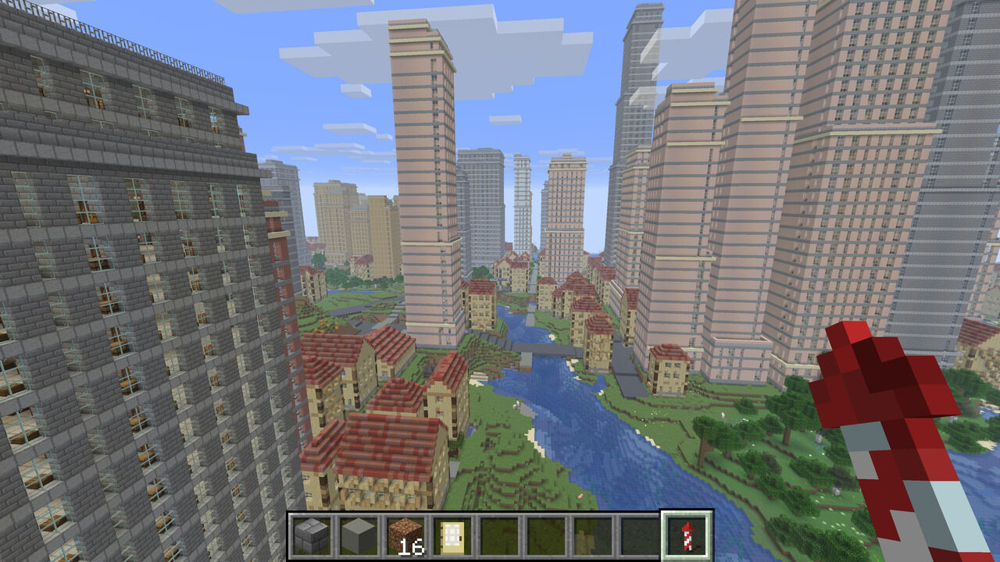

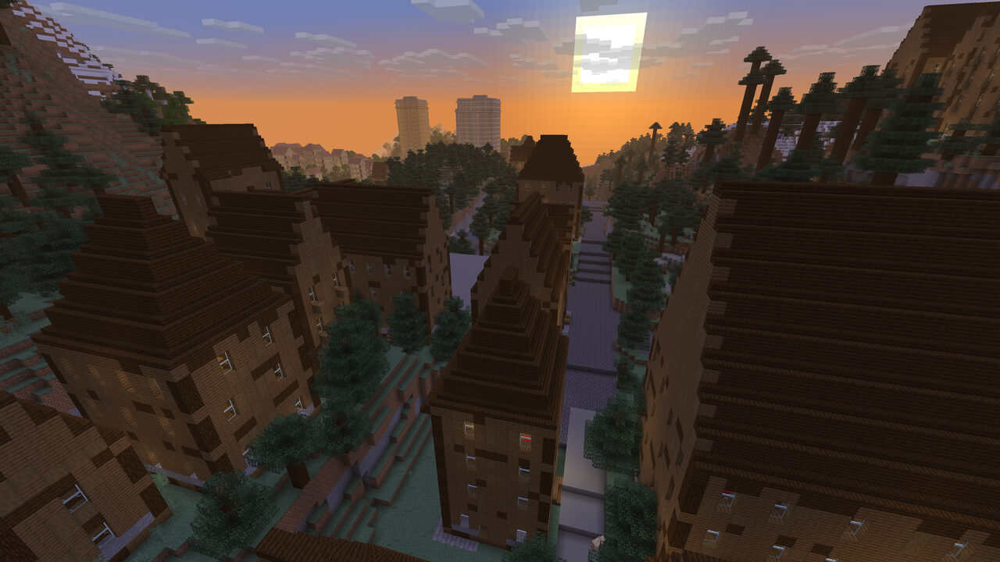
sunset over a mountain village with the big city in the distance
  - `-264 119 179` yaw -3164 pitch 25; taiga; settlement sm1_0 (city); district dm2_1; street b11_m304 (street, width 5)

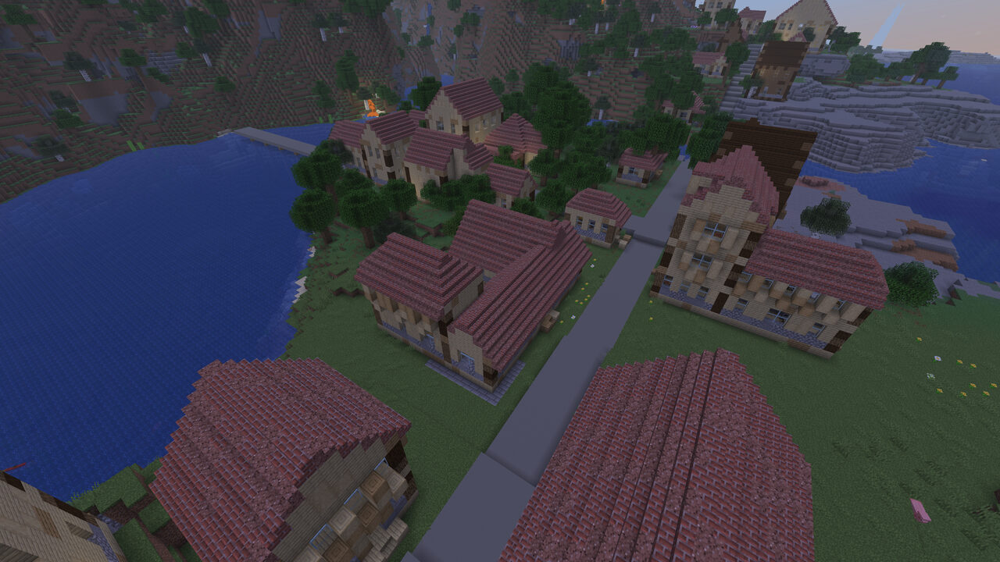
multiple wings in these homes.
  - `-790 97 600` yaw -3993 pitch 39; plains; settlement sm1_0 (city); district dm6_3; lot dm6_3.l7; building b6 (workshop, plains, seed -2174076105997648142, 2 storeys)

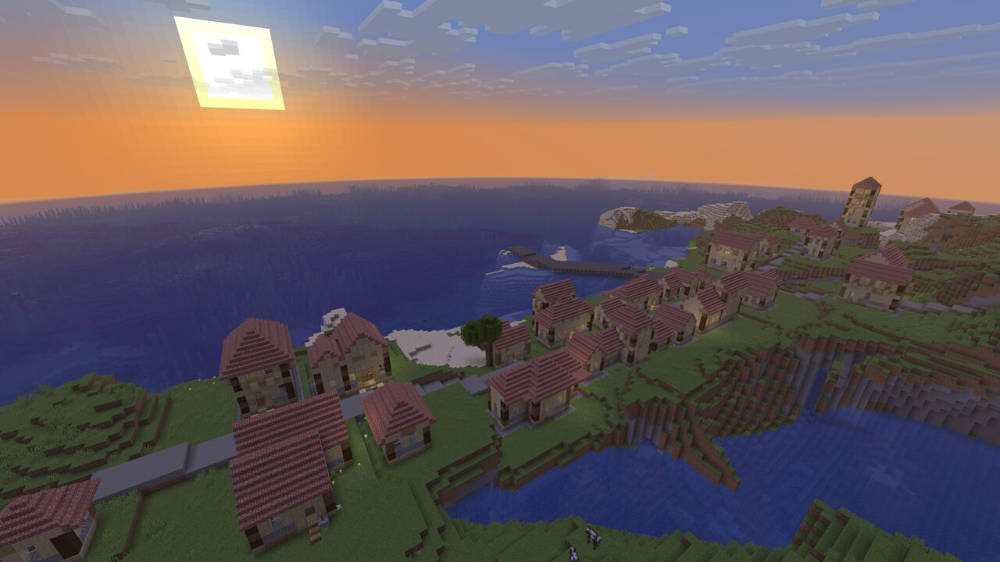
lovely beach side community
  - `-893 110 602` yaw -4917 pitch 22; plains; settlement sm1_0 (city); district dm6_3

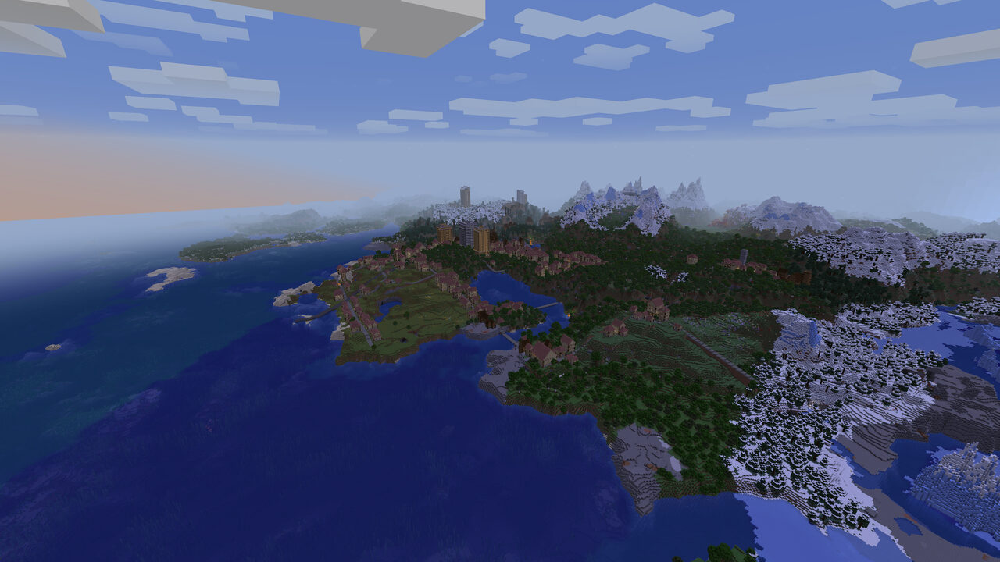
Pairs well with Distant Horizons
  - `-1006 287 1062` yaw -869 pitch 19; cold_ocean; outside any settlement

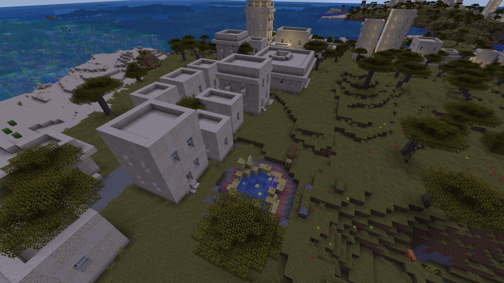
not where I'd put a house, but you do you! free geothermal heating?
  - `2725 101 4330` yaw -833 pitch 41; savanna; settlement s5_2 (metropolis); district d17_27

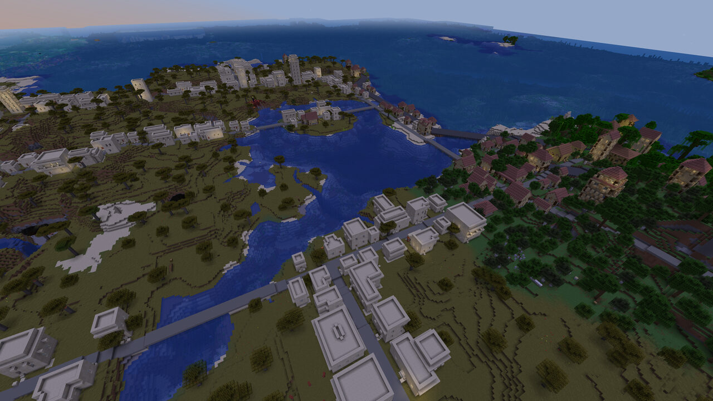
Small water crossings (proper bridges coming soon) 
  - `3194 165 4871` yaw -1233 pitch 40; savanna; settlement s5_2 (metropolis); district d19_30

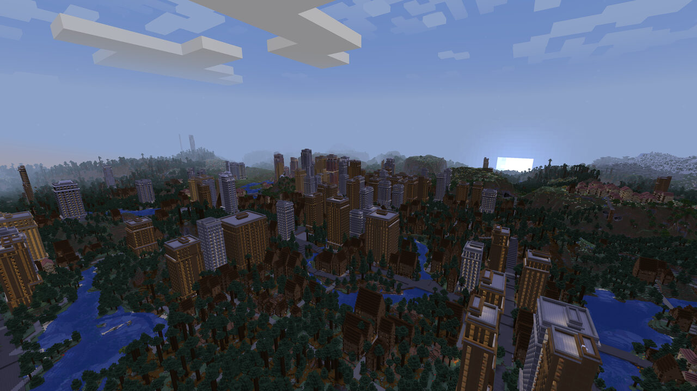
metropolis as the moon rises 
  - `4998 245 4001` yaw -2284 pitch 15; forest; settlement s5_2 (metropolis); district d31_24

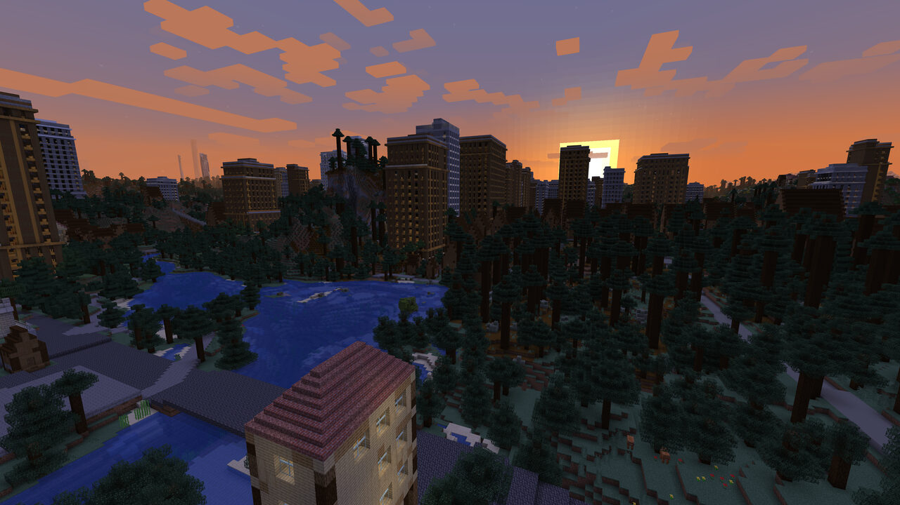
morning over temperate city
  - `4942 100 3801` yaw -2273 pitch 10; taiga; settlement s5_2 (metropolis); district d30_23

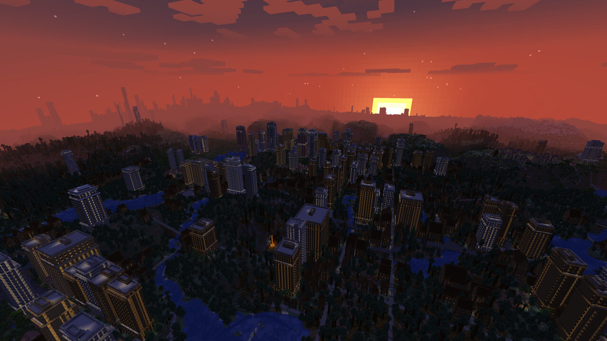
sunrise sky shot over metropolis 
  - `4915 308 3809` yaw -2271 pitch 21; forest; settlement s5_2 (metropolis); district d30_23

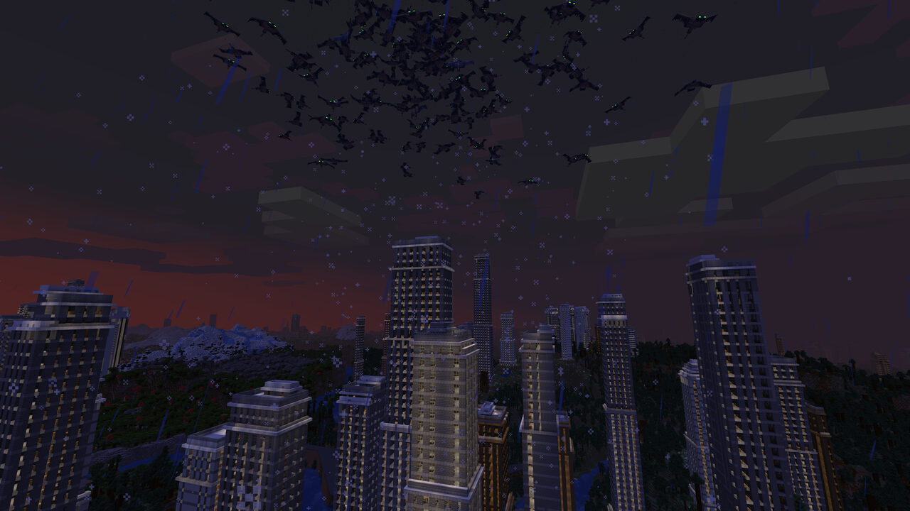
haunting by phantoms in a wintry mix. 
  - `5594 214 1967` yaw -2537 pitch -10; river; settlement s5_2 (metropolis); district d34_12

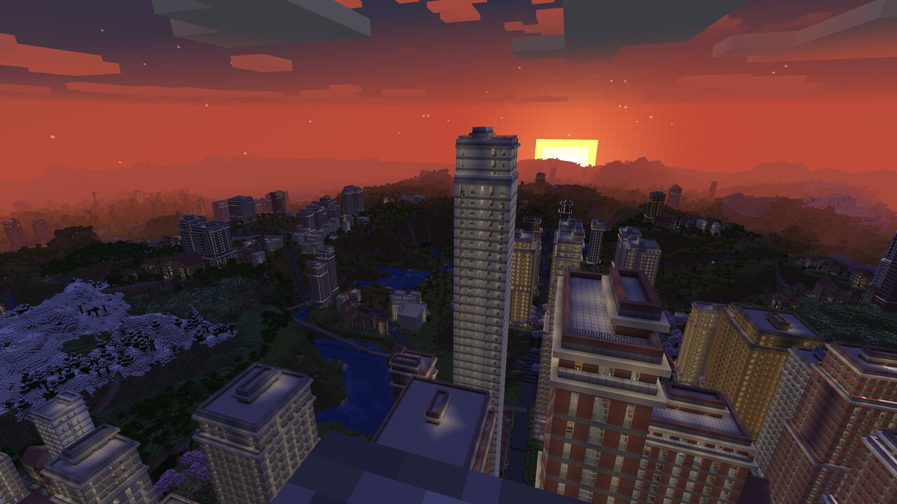
sunset from the tallest building 
  - `6394 315 2073` yaw -2627 pitch 20; forest; settlement s5_2 (metropolis); district d39_13; lot d39_13.l5; building b0 (highrise, tall-stone, seed 8461781401217549429, 51 storeys)
