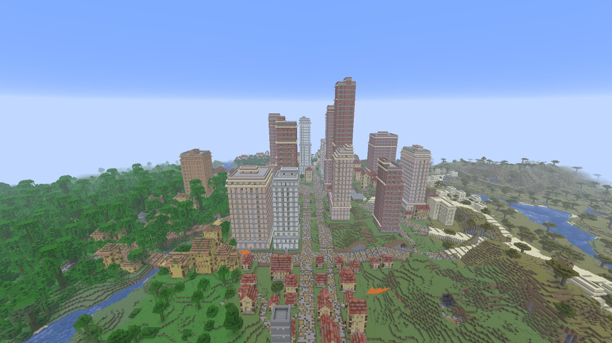

# Spike: client game tests on the Intel iGPU (gpu-intel)

## Question

Can the client game tests render on the Intel UHD 770 iGPU instead of lavapipe (Mesa's CPU
renderer), and what does that buy us? Also: John doubts our estimate of ~95 s of extra world
generation per camera site at render distance (rd) 32, because in his game a view draws in a couple
of seconds.

## Answer

**Yes.** `FB_VK=intel scripts/client-test.sh` renders with Mesa's Intel Vulkan driver (ANV) under
Xvfb. The client log says
`Using graphics backend Vulkan, using drivers: 1.4.354 Intel open-source Mesa driver Mesa 26.2.3`,
and the hello-hut screenshot and the probe screenshots look right. It needs one extra setting:
Xvfb has no DRI3, so Mesa can't present a GPU image to an X window ("No DRI3 support detected").
The device then reports no usable queue, Minecraft logs "Failed to create backend Vulkan" and sits
there without exiting. `MESA_VK_WSI_DEBUG=sw` makes Mesa render on the GPU and copy each finished
frame to the window through the CPU, and the script sets it. The flake's Mesa already ships
`intel_icd.x86_64.json`; `vulkan-tools` was added only so `vulkaninfo` can show which device was
picked. NVIDIA is refused by the script and the loader can't see it, since only the Intel ICD is
listed.

**What it buys: client frame time and cleaner shared cores, not faster world generation.** A loaded
rd 32 metropolis view draws in about 4 to 7 ms per frame on the iGPU, and the client draws the
chunks about 4 to 6 s after the server has them. Filling a view in the test harness is limited by
the **server**, at about 40 to 50 chunks/s whatever the renderer: rd 32 (3,461 chunks) takes about
80 to 90 s fresh. The ~95 s estimate holds for fresh chunks. John's couple of seconds was **not
reproduced** here, even for chunks that were already generated (67 s at rd 32). See "Why".

## Evidence

- Runs under the heavy lock through `scripts/evidence.sh gpu-intel`, in
  `.claude/reports/gpu-intel-evidence/`: `6f1753159d-20261026T164055Z` (Intel without the sw WSI
  setting: no backend, killed), `b567f6095f-20261026T171258Z` (run 1, load 2.5 to 5.4) and
  `f45ccb4b9e-20261026T191316Z` (run 2, load 1.9 at the start and 13 at the end, so other agents
  were busy during rd 32). Probe tables (TSV), logs and screenshots are in
  `.claude/reports/gpu-intel-runs/{intel,intel2}/` (not committed).
- Probe: a throwaway client test `GpuProbeClientGameTest` (SPIKE commits, kept off the mergeable
  branch). For each rd it opens a fresh world (seed 12345, metropolis `s0_5` at 640,5312, radius
  276) and times three teleports, from the `tp` until the client holds every chunk in view
  (`ChunkTrackingView.isInViewDistance`) and the section compile queue is empty: the metropolis
  (fresh), a wilderness point with no settlement in view (fresh), then the metropolis again
  (already generated). It samples every 0.5 s: server FULL chunks, client chunks, compile queue,
  FPS, frame time, process and system CPU.
- The iGPU was idle before the runs (runtime PM `suspended`). John's desktop and its apps run on
  the NVIDIA card (`renderD129`).

## Numbers (Intel; seconds after the teleport until 98% of the view is on the server / on the client)

| rd (chunks) | wild, fresh | metropolis, fresh (first chunk) | metropolis, already generated | frame ms while loading, mean / worst | frame ms, loaded |
|---|---|---|---|---|---|
| 10 (385) | 8.6 / 11.2 (run 2: 8.9 / 11.4) | 23.4 / 24.9 (14.8) | 6.4 / 8.0 | 2 / 10 | 2 to 3 |
| 24 (1,981) | 44.9 / 49.4 (41.8 / 47.1) | 47.7 / 50.8 (14.1) | 41.8 / 44.9 | 3 / 14 | 3 to 5 |
| 32 (3,461) | 79.7 / 85.5 (87.9 / 93.8) | 117.9 / 123.7 (13.8) | 66.8 / 70.5 | 13 / 178 | 4 to 7 |

- Fresh metropolis and already-generated numbers are from run 2. In run 1 the probe stopped the
  fresh-metropolis phase too early: its "metropolis again" was mostly fresh too (81.3 s at rd 32).
- The JVM used about 15% of the 20 cores (about 3) while filling a view, and about 30% during the
  first ~14 s at a fresh metropolis, when no chunk completed at all.
- FPS reads 30 in most samples because Minecraft caps an idle window ("reduce FPS when AFK"), so
  frame time is the number to trust. At the 1920x1080 wide camera, run 2 measured 11 ms per frame
  under load 13; that was not measured on a quiet machine.
- **Lavapipe: not measured in this spike** (the comparison run was cut when the coordinator asked
  me to wrap up). Reference point: NOTES (1.4) recorded 576 chunks in about 13 s under lavapipe,
  about 44 chunks/s, the same rate as on Intel, so the renderer doesn't set the fill rate.

## Why

- **Vanilla throttles chunk loads requested by players.** `DistanceManager` builds its "player
  ticket throttler" as a `ThrottlingChunkTaskDispatcher` with `maxChunksInExecution = 4` (read
  from the 26.3 bytecode). Only 4 player-requested chunks are in flight at once, so the fill rate is
  4 divided by one chunk's trip through the pipeline. Here that gives about 44 chunks/s fresh and
  about 50 to 60 chunks/s already generated, with about 3 cores busy. More cores don't help;
  shorter per-chunk latency would. Why loading saved chunks is so little faster is not verified.
  The likely cause is that ticket and promotion work runs on the server thread per tick, and
  Fabric's client test runner ticks the server in lockstep with the client.
- **Our mod's share.** The cold plan of a metropolis delays its first chunk by about 14 s (region
  layer, roads, district plans; see the budgets in `mod/perf-budget.json`). After that, filling
  costs about the same as wild land. Rd 32 took 30 s longer than wild in run 2, which is mostly the
  14 s wait plus noise from the load. How much of the per-chunk time vanilla would take without
  our mod was **not measured**: there is no switch to turn our worldgen off.
- **John's couple of seconds is not explained by the numbers here.** What would explain it,
  none of it measured: (a) chunks come nearest first, so the near half of a view arrives much
  sooner than the far ring (rd 10: half the view in 0.6 s when already generated; rd 32: 22 s);
  (b) in his game the chunks were still in memory (flying back over loaded land), or he plays at a
  lower render distance; (c) the test runner's lockstep slows the server's chunk work in a way a
  normal game doesn't. Settling it needs one timing outside the test runner (`runClient` on Intel,
  or his desktop) with the same teleports. **Not measured.**
- **The renderer matters on lavapipe in another way.** Since the runner ticks client and server
  together, slow lavapipe frames also slow server ticks, and chunk scheduling and sending with
  them. On Intel the tick rate stayed at 20 (17 to 19 at rd 32 under load).

## What it means

- **Fly-through:** run it on Intel (for example `FB_VK=intel scripts/flythrough.sh --rd 16`) for
  larger frames at a higher render distance without lavapipe's frame cost. Each new camera site
  still pays the generation time for its view: about 25 s at rd 16 (estimated, not measured) and
  80 to 120 s at rd 32, plus about 14 s for a cold metropolis plan. Frames inside the same
  settlement after the first are cheaper, but not free.
- **perf.sh:** its server rows don't depend on the renderer. Running its world half on Intel takes
  lavapipe off the shared cores, which cuts noise. A client frame-time row (mean and worst frame
  while a city's chunks arrive) is now possible: rd 32 showed a 178 ms worst frame while a fresh
  metropolis streamed in.
- **Frame time:** a rd 32 metropolis view draws in about 4 to 7 ms on the UHD 770 (an iGPU). John's
  NVIDIA card would be faster.
- **Unchanged:** the default stays lavapipe. Intel runs still take the heavy lock, and timing
  numbers still need a quiet machine.
- **Wide shot:** rd 32, 1920x1080, clouds off, from about 280 blocks south and 100 up. The whole
  metropolis sits in one frame, with jungle, savanna and a river around it.

**Couldn't verify:** vanilla generation speed without our mod; why already-generated chunks load
only a little faster; the GPU's own load (no `intel_gpu_top` for this user); what the sw present
path costs at large windows on a quiet machine; lavapipe at rd 10 and 24 in this harness.
