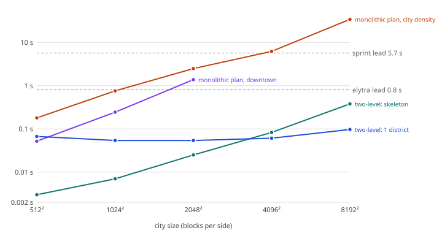

# S6 Scale and cost

## Question

What do piece counts and city size do to plan time, save size and chunk generation time at village, town, city and metropolis scale? How large can a city go (John wants effectively unbounded cities; 512² is only the floor)? Plus the pool research's list: lane time by part (cold and warm), block-write cost, prefetch lead for walking, sprinting, elytra and Chunky, worker contention, cache memory and evict-and-compare. Plus the coordinator's late additions: the cost of one city-suitability decision, `/locate` through many unsuitable cells, and evict/regenerate equality with probe-derived heights.

## Result

**No ceiling in the plan, as long as it is two-level. The ceilings are the monolithic whole-cell plan, the serial lane, and vanilla chunk throughput.**

1. **Plan cost is pieces times one exact probe, not area.** An exact height (`getFirstFreeHeight`) costs 0.15-0.38 ms live. A monolithic cell plan (every building probed on first touch) costs about **0.5 s per Mblock² at city density**: 0.76 s at 1024², 2.5 s at 2048², 6.2 s at 4096², **34 s at 8192²** (108k buildings). The ARCHITECTURE estimate (about 8 s at 2048²) was 3x too high for this density, but the shape (linear in pieces) holds, and a downtown (60 big pieces per district) is 5x cheaper per area.
2. **The two-level plan removes the size dependence.** Skeleton (coarse height screen, 32-block stride, roads on hashed lines): 7 ms at 1024², 25 ms at 2048², 83 ms at 4096², 379 ms at 8192², quadratic in side (about 1.5 s at 16384², 6 s at 32768² extrapolated; 2 bytes per 32x32 cell). District detail: **40-100 ms and constant** whatever the city size. Neighbouring cells need no coordination: arterials are a pure function of (seed, axis, line index), and gates on a shared cell border derive from a hash of the edge.
3. **The serial lane is real.** `postProcess` never ran on more than one thread at a time (peak concurrency 1 in all 20+ runs, also with 8 requesting threads). So per-district lane time is the sum over its pieces. Cold (generator inline): village 55 ms, town 0.24 s, city 1.2 s, **downtown 6.5 s, dense downtown 20 s**, against about 7 s for vanilla's 256 chunks. Warm (everything prefetched): 21 ms, 31 ms, 35 ms, **0.5 s, 0.4 s**. The remainder is block writes.
4. **Prefetch works, and is enough without a pool.** Start-created to first-`postProcess` lead is about 2 chunks of player travel (about 26 blocks, measured at three speeds): 0.8-1.0 s at elytra, 5.7 s sprinting, 7.5 s walking (15 s in the first, loaded run), 60-350 ms for Chunky. With 4 workers and the district's IR submitted at start creation, **0 of 244 IR lookups ran inline at elytra speed, sprinting and walking** (lane lookup time 6.5 s -> 9 ms). Chunky: 12 of 469 lookups inline (8% of the cold lane time). Decision rule from the pool research (> 5% inline at elytra) is not triggered: **do not pool.** Teleporting into a downtown has no lead at all and pays the cold 6.5 s; see Recommendations.
5. **Evict-and-regenerate is byte-exact, including heights from live probes.** In the world: 0 of 885 chunks differ in write digest between a forward run and an 8-thread run with 4 prefetch workers and an evictor clearing the caches every millisecond (122k evictions); the district plan hash (with probe heights) and skeleton hash are equal. Pure: 0 IR and 0 plan mismatches at 1-16 threads. The mutants (hidden counter in the IR, in a probe) fail it.
6. **A trap the evict test exposed:** when every `postProcess` re-reads the district plan from the cache, a cache that thrashes rebuilds a 68 ms district plan per lookup (1755 rebuilds, 119 s). Pieces should carry their brief (about 40-60 bytes) or the plan entry must be pinned while a start is live. A rebuild is still exact.

## Quiet-machine re-measure (r2, same day, nobody else running)

Every number from here on in this section was taken with nothing else running except this harness. loadavg was 0.56-1.93 at the start of each batch (`q.notes`: 0.56, 1.70, 1.93 for the three plan/scale batches; 1.93, 1.96, 1.94 for the three prefetch/contention batches; 1.88 for walking) and 2-8 during runs, which is our own client and prefetch/spinner threads (lavapipe uses several cores). Three full repeats (A: plan, suitability, `/locate`, per-district, 1024² cities; B: elytra, sprint, Chunky, contention); walking was run once per mode (about 2 min each). Spread is min-max over the repeats. The first (loaded) tables further down are kept as a noise comparison.

**What changed:** (1) *contention*: the earlier "no slowdown" was an artefact of a fast, probably ocean, test area; on land 8 busy workers cost 22% and 16 cost 44% of chunk throughput (4 workers: 3%). Cap prefetch workers at 4 until measured on the real generator. (2) *walking lead*: 7.5 s, not 15 s (the loaded server had been running at 9 TPS); the lead is still about 26 blocks of travel. (3) 8192² monolithic plan: 29.5 s, not 34 s. Nothing else moved by more than about 10%; the lane counters were already stable and every conclusion stands.

| Plan time (city density), live probes | Skeleton (ms) | Largest district (ms) | Monolithic rest of cell |
|---|---|---|---|
| 512² | 3-4 | 62-81 | 174-198 ms |
| 1024² | 7-8 | 53-61 | 750-781 ms |
| 2048² | 25-26 | 53-64 | 2.50-2.55 s |
| 4096² | 82-83 | 58-62 | 6.21-6.42 s |
| 8192² | 349-389 | 57-59 | **29.2-29.7 s** (107,862 probes) |
| downtown 512² / 1024² / 2048² | 2 / 7 / 25-26 | 14-16 | 44-47 ms / 221-228 ms / 743-769 ms |

First start of a 1024² city (16 districts, `scale:city:cold:4`): monolithic **786-789 ms**, two-level **60-79 ms** (all 16 starts together 808-862 ms in both); lane time identical (14.26-14.30 s, 13.78 s of it IR inline); wall 98-100 s (23.9-24.4 ms per chunk; no-city 25.9-26.8 ms per chunk at 1 district).

| Lane time per district (ms), 3 repeats | Start (plan) | Cold: postProcess (IR inline / writes) | Warm: postProcess (writes) |
|---|---|---|---|
| village (19 pieces) | 8 | 41-43 (30-32 / 10.4-10.9) | 13.4-14.3 (7.7) |
| town (159) | 44-46 | 235-237 (216-217 / 18.6-19.2) | 25.7-27.6 (19.8-20.9) |
| city (177) | 50-51 | 1,196-1,200 (1,165-1,170 / 29.6-30.5) | 34.4-36.4 (29.4-31.2) |
| downtown (58) | 14.5-14.7 | **6,534-6,547** (6,020-6,023 / 510-525) | **512-541** (507-536) |
| dense downtown (229) | 50 | 19,132-19,142 (18,869-18,871 / 260-273) | 273-288 (268-283) |

Wall per chunk: cold downtown 53.9-55.0 ms, warm 30.5-32.0 ms, village without a city 25.9-26.8 ms; dense cold 100 ms, warm 27.7-28.1 ms. Peak concurrent `postProcess` stayed 1 in every run.

| Suitability (400 samples per cell decision) | median over 24 cells, 3 repeats | `/locate` (cells decided, time) |
|---|---|---|
| coarse screen | **11.1-11.6 ms** (p90 12.6-13.0) | 7-12 cells: 106-235 ms |
| exact heights | **128.9-132.8 ms** (p90 134.6-138.1) | 19 / 192 / 28 / 69 cells: 2.5 s / **25.0-25.4 s** / 3.7-3.8 s / 9.0-9.1 s (129-132 ms per cell) |

| Prefetch (downtown, 4 workers) | Lead start -> first post | IR lookups done / inflight / inline | Lane time in IR lookups | Notes |
|---|---|---|---|---|
| elytra, no prefetch (n=3) | 0.89-1.00 s | 179 / 0 / 65 | 6.56-6.58 s | 33.1 blocks/s, district finished 14.4 s after entering view |
| elytra, on start (n=3) | 0.87-0.97 s | **244 / 0 / 0** | 7.8-8.5 ms | 28-29 blocks/s (workers compete for the same cores); finished 10.8 s after view |
| elytra, ahead 256 (n=3) | 0.93-1.08 s | 244 / 0 / 0 | 7.5-8.2 ms | |
| sprint, none / on start (n=3 each) | 5.72-5.77 / 5.66-5.80 s | 179/0/65 / 244/0/0 | 6.54 s / 6.8-7.4 ms | 4.66 blocks/s actual (16.6 TPS) |
| walk, none / **on start (first measurement)** / ahead 256 (n=1 each) | 7.48 / 7.47 / 7.57 s | 179/0/65 / **244/0/0** / 244/0/0 | 6.55 s / **7.1 ms** / 7.5 ms | 3.57 blocks/s actual (16.6 TPS); district done at the same time in all modes (player-paced) |
| Chunky, none (n=3) | 54-57 ms | 354 / 0 / 118 | 11.89-11.90 s | 32.3-32.7 chunks/s |
| Chunky, on start (n=3) | 61-71 ms | 456-457 / 3-4 / 12 | 1.19-1.21 s | 40.8-41.6 chunks/s; no city: 46.1-46.3 |

Even on a quiet machine the client in the same JVM keeps the server near 16.6 TPS while moving; the lead in blocks (about 26) is what carries over to a real server.

| Contention: 576 land chunks, 8 requesting threads (6 runs each, chunks/s) | Range | Mean | vs 0 workers |
|---|---|---|---|
| 0 busy workers | 99.0-104.9 | 102.0 | |
| 4 | 96.3-101.7 | 98.8 | -3% |
| 8 | 73.9-84.5 | 79.6 | **-22%** |
| 16 | 56.1-58.9 | 57.3 | **-44%** |

Test area: the land cell found by `findLand`. The machine has 20 CPUs, the client and vanilla workers use many of them, and the busy workers spin on CPU time (the worst case; real prefetch workers idle between tasks).

---

The rest of this note (below) is the first, loaded-machine run (loadavg 5-20); it is kept for the noise comparison and for experiments not repeated (probe costs, save size, memory, evict, gates).

## Method and honesty notes

- Harness (throwaway, `claude/spike-s6`, branched from S3): a stand-in generator (`spike6/`): boxes-IR buildings (houses 1 ms CPU, mid towers 50 ms, tall towers 200 ms, as thread CPU time spin), districts of 16x16 chunks (one start each, box reaches exactly 8 chunks), profiles village / town / city / metro (downtown, 2x2-chunk towers) / dense. Real probes and real chunk generation in **fresh normal overworlds** (client game tests, seed 424242, structure step `top_layer_modification` as S3), run through `spike-s6-run.sh <outdir> <runs>` (heavy lock, Xvfb). Pure experiments: `java -cp mod/build/classes/java/main dev.fractalbuildings.spike6.S6Pure profiles|scale|irmem|evict|gates`.
- Real player movement: the first player is made a spectator and teleported every server tick at a fixed speed (4.3, 5.6, 33 blocks/s), so tickets, view distance (8) and generation follow as for a real player. Speeds are per tick: at 9-16 TPS the wall-clock speed fell (sprint ran at 4.0-4.6, walk at 1.9-2.1 blocks/s), which is what a lagging server does too.
- **Load (first run):** the machine was shared; the quiet re-measure section above supersedes the load-sensitive numbers. loadavg is the first line of every result file: 5-20 (most runs 7-15). **Lane stats (summed `postProcess` time, IR time, plan time) repeat within 3%** (metro cold 6.52 / 6.61 s, warm 0.51 / 0.53 s, city cold 1.20 / 1.22 s). **Wall-clock per chunk does not** (20-58 ms per chunk, +-25%), so compare wall times only as ratios within a batch. Region bytes repeat to 0.03%. **Anything quoted as ms per chunk, chunks per second, or tick rate needs a quiet-machine re-measure before it decides a gate.**
- Stand-in limits: real generators are 5-20x more expensive than the toy (pool research), tower IR here is 35-50 KB compact where that note guessed 600 KB, and the stand-in writes air as well as solid. The cost model is linear, so the results scale; absolute numbers do not.

## Evidence

### Probe and block-write costs (live, `probes` run)

| Operation | Cost |
|---|---|
| exact height `getFirstFreeHeight`, random columns | median 382 us (p90 467) |
| exact height, neighbouring 16-block grid | median 155 us |
| coarse height (`chunk_surface_level`, uncached), +16 bias correction | median 28 us uncached, about 5.8 us on a 32-block grid (plan runs) |
| biome lookup (caching resolver) | median 4.3 us |
| coarse bias (exact - coarse), land | mean +16.5 blocks |
| `ProtoChunk.setBlockState` solid into empty / pattern | 90 / 92 ns per block |
| same, air into empty (no-op) / air over solid (clear) / same state | 29 / 100 / 66 ns |
| `LevelChunkSection.setBlockState` (floor) | 11 ns |
| whole pipeline (`WorldGenRegion.setBlock` from our pieces, all blocks incl. air) | **92 ns per block** (downtown), 126-147 (city, town), 290-340 (village: tiny pieces, per-piece overhead) |

The write floor is about 100 ns per block through the real pipeline: 30k solid blocks per downtown chunk would be about 3 ms per chunk, 10-15% of vanilla's 25 ms. Our downtown averaged 9.8k solid + 11.1k air blocks per chunk (max 17.5k solid); the 30k figure was not reached.

### Plan time against city size (live probes, `plan:32`, city density unless noted)

| Size | Skeleton (coarse probes) | One district (largest) | **Monolithic rest of cell** | Buildings (exact probes) |
|---|---|---|---|---|
| 512² | 3 ms (256) | 67 ms | 0.18 s | 566 |
| 1024² | 7 ms (1,024) | 54 ms | 0.76 s | 2,756 |
| 2048² | 25 ms (4,096) | 54 ms | 2.5 s | 9,148 |
| 4096² | 83 ms (16,384) | 61 ms | 6.2 s | 22,883 |
| 8192² | 379 ms (65,536) | 97 ms | **34 s** | 107,862 |
| downtown 512² / 1024² / 2048² | 2 / 8 / 29 ms | 16-43 ms | 52 ms / 0.24 s / 1.4 s | 187 / 919 / 3,090 |

Layout (lots, hashing) is 0.1% of the time (21 ms of 34 s at 8192²). The location was a mix of land and water, so counts include the coarse-screen water veto. Heap: skeleton 2 B per 1024 blocks²; a district plan about 58 B per building (733k buildings: 43 MB at 16384²). Chunk generation in the world: first start of a 1024² city (`scale:city:cold:4`, 16 districts): **775 ms monolithic against 61 ms two-level**; at 512²: 273 against 75 ms. Total lane time was identical (the work only moves).

First-touch budget: the work a start does is waited for by the chunk that triggers it. The lead at the start (below) is the budget: elytra 0.8 s (monolithic OK to about 1000²), sprint 5.7 s (to about 4000²), walk 6 s-15 s. Nothing in the two-level plan comes near it at any size.

### Lane time per district by part, cold and warm (`scale`, 1 district, 256 chunks, forward order)

| Profile | Pieces | Start (plan) | Cold: postProcess, of which IR inline | Warm: postProcess, of which writes | Blocks written (solid + air) | ms/chunk cold / warm / vanilla (noisy) |
|---|---|---|---|---|---|---|
| village | 19 | 17 ms | 55 ms, 42 ms | 21 ms, 9 ms | 14k + 22k | 31.6 / 28.8 / 35.8 |
| town | 159 | 62 ms | 237 ms, 218 ms | 31 ms, 20 ms | 75k + 54k | 27.6 / 26.6 |
| city | 177 | 51 ms | 1.20 s, 1.17 s | 35 ms, 29 ms | 144k + 95k | 31.9 / 26.4 |
| **downtown** | 58 | 15 ms | **6.52 s, 6.02 s** | 0.51 s, 0.50 s | 2.52M + 2.85M | 54.3 / 32.1 (threads8: 46.8 / 22.3) |
| dense downtown | 229 | 53 ms | 20.1 s, 19.7 s | 0.40 s, 0.38 s | 1.67M + 1.12M | 118 / 42 |

- Cold IR time matches the nominal budget (downtown 6.02 s against 5.85 s). Vanilla for the same 256 chunks was about 7 s, so a cold downtown district nearly doubles it and a cold dense one triples it. Wall time rose by the lane time (14.8 s cold, 8.1 s warm).
- Thread names: starts and posts all run on `Worker-Main-n` threads. Peak concurrent `postProcess` = 1 (8 requesting threads too).
- Multi-district cities, city profile, cold: 512² (4 districts) 4.2 s lane of 33 s wall; 1024² (16 districts, 4096 chunks) 14.3 s lane of 98 s, 13.7 s of it IR inline. About 14% of vanilla's time without prefetch, 0.5% with.
- Parts not separately visible: placement test (3-36 ns, S3), clip (inside the piece loop; its cost is below the noise), save (below).

### Save size against piece count (`sweep`, tiny pieces at hashed positions, one start of N pieces)

| N pieces | Start gzip NBT | Per piece | Start-chunk region payload | Reload (`loadStaticStart`) | 256-chunk generation |
|---|---|---|---|---|---|
| 10 | 305 B | 30 B | 8.4 KB | 0.6 ms | 31.8 ms/chunk |
| 100 | 1.4 KB | 14.5 B | 9.8 KB | 0.7 ms | 30.0 |
| 1,000 | 13.1 KB | 13.1 B | 21.6 KB | 2.8 ms | 27.2 |
| 10,000 | 128.6 KB | 12.9 B | 141 KB | 21 ms | 29.2 |
| 100,000 | **1.28 MB** | 12.8 B | 1.29 MB (external `.mcc` file) | 46 ms | 29.4 |

- Pieces store one `IntArray` (gx, gz, kind, idx, baseY) plus vanilla's id/BB/GD/O: 13 B per piece compressed (S3's seven separate int tags: about 20 B). Linear to 100k pieces.
- Chunk generation time does not move with N up to 100k pieces (`placeInChunk` tests every piece box per chunk: 100k x 289 chunks is below the noise). The start's own creation is O(N) and cheap (21 ms at 10k).
- **A region slot holds at most about 1 MB (255 sectors); vanilla overflows larger chunks into an external `.mcc` file and that worked here, so this is not a hard limit.** Reference pieces would reach it at about 80k pieces per start. A district cannot get near that (one piece per 6 blocks² = 11k).
- **Stored IR instead of a reference** (`probes`, one piece, gzip NBT): reference 102 B always; stored 349 B (10x8x8 house), 2.5 KB (12x12x70), 11 KB (25x25x150), 24 KB (25x25x220). A downtown start of 58 stored towers is about 0.7-1.4 MB, around the point where vanilla overflows to `.mcc`. Save references or briefs, never IR (size, not a hard limit). (The `sweepstored` run used 2x2x2 pieces and says nothing; use this table.)
- Whole-region effect of the city (bytes of the 256-chunk box against the no-city world, same seed and place; noise 0.03%): village +0.9%, town +2.8%, city +3.7%, downtown +6.4%, dense +9.1%; 1024²: +3.4% (512²) and +4.4% (4096 chunks). Built blocks compress to about 0.03 bytes each. Start chunk payload: 8.8 KB without, 9.3 KB village (26 pieces), 11.9 KB town (159), 12.3 KB city, 10.3 KB downtown (58). Every chunk within 8 of a start also stores one start reference (a long).
- `saveEverything` of the district world: 0.7-1.3 s (3.5 s with the 100k sweep world); dominated by vanilla.

### Prefetch lead (`prefetch`, downtown, 2 districts in a row, view distance 8, 4 workers)

Lead = start created to first `postProcess` of that district, wall clock, load in brackets.

| Movement (nominal b/s) | Actual b/s | Lead (district 0) | Prefetch | IR lookups done / inflight / inline | Lane time in IR lookups | District finished after entering view |
|---|---|---|---|---|---|---|
| elytra (33) | 33.0 | 0.91 s [5.0] | none | 179 / 0 / 65 | 6.56 s | 14.7 s |
| elytra | 28.3 | 0.77 s [5.3] | on start | **244 / 0 / 0** | 8.8 ms | 10.9 s |
| elytra | 27.3 | 1.03 s [10.4] | ahead 256 | 244 / 0 / 0 | 9.7 ms | 10.7 s |
| elytra | 30.3 | 0.99 s [10.7] | ahead 768 | 244 / 0 / 0 | 7.6 ms | 10.5 s |
| sprint (5.6) | 4.6 | 5.7 s [9.1] | none | 179 / 0 / 65 | 6.56 s | 58 s |
| sprint | 4.5 | 5.8 s [8.6] | on start | 244 / 0 / 0 | 9.4 ms | 61 s |
| sprint | 4.0 | 5.7 s [6.2] | ahead 256 | 244 / 0 / 0 | 9.2 ms | 71 s |
| walk (4.3) | 1.9 | 15.0 s [15.8] | none | 179 / 0 / 65 | 6.66 s | 143 s |
| walk | 2.1 | 14.9 s [17.9] | ahead 256 | 244 / 0 / 0 | 10 ms | 119 s |
| Chunky-style (16 in flight, 1536 chunks) | 31.7 chunks/s [10.1] | 60 ms | none | 354 / 0 / 118 | 11.9 s | |
| Chunky | 41.0 chunks/s [6.2] | 75 ms | on start | 457 / 3 / 12 | 1.17 s | |
| Chunky, no city | 46.0 chunks/s [5.1] | | | | | |

- **Lead is about 26 blocks (1.6 chunks) of player travel at every speed**: 0.8-1.0 s at 28-33 blocks/s, 5.7 s at 4.5, 15 s at 1.9 (the lead in ticks was 130, 91 and 18, times blocks per tick). So the first-touch budget on the lane shrinks with speed, and a teleport has none.
- The first tower is needed 0.8 s after the start, yet nothing ran inline at elytra speed: the lane's `postProcess` of the district spreads over 7-10 s (it is chunk-bound), so the 4 workers (1.5 s for the 5.9 s of downtown IR) stay ahead of every piece after the first few. Inline only appears when the lane arrives at once (Chunky: 12 inline lookups = 0.95 s, 8% of the cold 11.9 s) or the pool is empty.
- With IR prefetched a downtown finishes about 4 s (26%) earlier at elytra speed; at sprint and walk the district is bound by the player's pace and the totals show only noise (the IR time left the lane: 6.6 s -> 10 ms).
- Elytra at 33 blocks/s asks for 33 chunks/s of frontier; vanilla delivered 25-46 chunks/s on this loaded machine. Elytra outruns generation with or without a city.
- "Ahead" prefetch (trigger distance 256 and 768 blocks from the district box) bought nothing over on-start here because on-start was already enough. It earns its keep only where the lead is short and the tower bill large (a faster-than-elytra player, a bigger downtown, fewer workers).

### Worker contention (`contend`, 576 chunks, 8 requesting threads, same world seed and area, fresh world each)

| Busy spinning workers | Run 1 | Run 2 |
|---|---|---|
| 0 | 4.73 s (122 chunks/s) [7.3] | 3.59 s (161) [10.4] |
| 2 | 4.72 s (122) [7.0] | 3.45 s (167) [11.5] |
| 4 | 4.70 s (122) [11.9] | 3.68 s (157) [11.2] |

**Superseded by the quiet re-measure on land (8 workers -22%, 16 workers -44%).** No measurable slowdown from 2 or 4 busy workers (within 5% in both pairs). The test area happened to generate at 122-167 chunks/s, much faster than the 25-45 chunks/s of the land areas, so it may be mostly ocean; the machine has 20 CPUs and 4 workers use 20% of them. Re-measure on a quiet machine with a land area and 8-16 workers before deciding the worker cap.

### Cache memory and evict-and-regenerate (`S6Pure irmem|evict`, `evict` world run)

- IR compact (`short[]` boxes, 14 B per box) against objects (records, 48 B per box): house 0.7 KB / 2.4 KB (3.6x), 12x12x70 tower 6.8 / 21 KB, 28x28x150 tower 35 / 113 KB, 28x28x200 tower 49 / 152 KB: **3.1-3.6x** for compact. Per district compact: village 11 KB, town 130 KB, city 267 KB, **downtown 2.15 MB, dense 2.95 MB** (6.6 MB / 9 MB as objects). Plan: 58 B per building. A bounded LRU of 64 downtown districts is about 140 MB compact; real towers (several times more boxes) will need the memoised-floor forms from the pool research.
- Pure: IR prefetched on 1, 2, 4, 8 and 16 threads with an evictor clearing the cache every 0.5 ms (about 350 evictions): **0 IR and 0 plan mismatches** against a single-thread reference in 5,580 lookups. Mutants: counter in the IR salt -> 123-2,059 IR mismatches; counter in a probe -> 181-2,896 plan mismatches.
- World (`evict`, city profile, 512²): forward cold run against 8 shuffled threads + 4 prefetch workers + evictor (1 ms, 121,928 evictions, 1,755 district plan rebuilds with 318k live probes): 972,729 blocks written in both, **0 / 0 / 885 chunks differ / missing / total** in the order-independent write digest; district plan hash with live heights and skeleton hash equal before and after. The test is `# FAIL`-marked when anything differs. In-world mutant (hidden counter in the IR, evictor 20 ms): 43 of 885 chunks differ and the run fails.
- Cache sizes in a 4-district world: 1 skeleton, 4 district plans, 726 IRs.

### City suitability and `/locate` (`suit`)

Best of 8 candidate centres, about 50 footprint points each (400 samples, each a height and a biome lookup), as S4:

| Heights | Per cell decision (median, p90) | Per sample |
|---|---|---|
| exact (`getFirstFreeHeight`) | **137-185 ms** (p90 146-232) | 0.34-0.46 ms |
| coarse screen (bias-corrected) | **12-17 ms** (p90 13-20) | 30-42 us |

`/locate` (`findNearestMapStructure`, radius 100, cells 2048, half the cells candidates, suitability in `findGenerationPoint`, cached per cell): the cost is the number of cells examined times the decision cost, nothing else.

| Heights | From | Cells decided (suitable) | Time |
|---|---|---|---|
| exact | (0,0) | 19 (1) | 3.4 s |
| exact | (150k,-90k) | 192 (1) | **34 s** |
| exact | (-200k,300k) | 28 (1) | 4.9 s |
| exact | (500k,500k) | 69 (1) | 11.5 s |
| coarse | (0,0) / (150k,-90k) / (-200k,300k) / (500k,500k) | 12 / 7 / 12 / 7 (1 each) | 260 / 116 / 218 / 126 ms |

The threshold (85% land within 400 blocks and relief < 40) passed only 1 in 7-190 candidate cells in this world; the pass rate is a tuning choice, the per-cell cost is the fact. The `locate` call also builds the found cell's first district start (included). Do not use exact heights for the suitability screen. (Exact and coarse ran in separate worlds because vanilla caches the `StructureCheck` answers per world.) Live probes only; a recorded-grid replay (S4) would be faster still.

### Cells joined at hashed gates (pure, `S6Pure gates`)

Two cells planned independently, the crossings on their shared border derived from a hash of the edge key (`seed, edge x, edge z`), 9,800 edges (200 seeds, 7x7 cells), 34,511 crossings: **0 mismatches.** Arterial roads are a function of (seed, axis, line index) and agree across cells with no gate at all. This is a determinism check of the rule only; it does not generate anything, and the crossing still has to be built by both cells' pieces (S3 showed that one side owning each block works). **Untested in the world.**

## What it means for the design

1. **Adopt the two-level plan as ARCHITECTURE describes it, and keep exact probes out of the skeleton.** Skeleton = coarse screen at 32-block stride (5-6 us a probe on a grid) + hashed arterials; detail = exact probes only at building sites, per district. The skeleton cell should be at most 4096² (83 ms); a city is any number of adjacent cells. That puts no ceiling on city size from the plan: 8192² would be 1,024 districts and 4x the skeleton work per cell, still under 0.4 s.
2. **What the two-level plan must achieve** (measurable acceptance numbers): skeleton for a cell < 100 ms and 2 B per 1024 blocks²; district detail independent of city size, < 100 ms at 200 exact probes (0.3 ms each; fewer probes by probing lot centres, never columns); a district computable from the skeleton alone (no neighbour's detail); briefs identical after eviction and rebuild; and total first-touch work at a start below the lead (1 s elytra, 0 for teleport).
3. **The pieces must be restartable without the district plan.** Store (or recompute from the key) the brief per piece, ~40-60 B, and let the IR cache key on it. Otherwise one `postProcess` miss rebuilds a whole district (68 ms) and a thrashing cache costs minutes.
4. **Prefetch the district's IR at start creation with at most 4 workers (8 cost 22% of chunk throughput, 16 cost 44%, quiet machine); no pool.** That removed the cold lane time (6.5 s -> 9 ms) at every player speed; the real generator's 5-20x multiplier needs the same pool of workers to be 5-20x busier (1.5 s of wall for the toy -> 8-30 s per downtown district at 4 workers), so size the lead by measuring the real generator, and re-run this with it. For teleport and similar no-lead arrivals, build the cheap skeleton shell first (roads, foundations, tower masses) and let the detail land on later `postProcess` passes, or accept the cold 6.5 s.
5. **Per-district budget.** Lane time at warm cache is dominated by block writes: about 100 ns per block through the pipeline. Budget a downtown chunk at 3-5 ms of writes, the rest of the cost is the generator.
6. **Save references.** 13 B per piece, 100 B per piece with its NBT overhead, a chunk larger than about 1 MB overflows to an external `.mcc` file (works, but a separate file per big start): about 80k reference pieces or 50-100 stored towers. The size argument for references stands (13 B against 11-24 KB per piece), the overflow is not a failure. Keep a district under ~10k pieces (it will be) and never store IR in pieces.
7. **Practical limits.** (a) City size: no limit from the plan; the practical limit is how fast chunks generate: 4096² is 65k chunks (about 40 min at 25 chunks/s), 8192² is 262k chunks (about 3 h). (b) Suitability: coarse screen only (12-17 ms); exact heights make `/locate` take seconds to minutes. (c) District detail: at most about 200 exact probes per district on the lane unless prefetched. (d) Monolithic whole-cell plan: acceptable to about 1024² for a single settlement, the default for 6.5 "maximum city size" can stay at "unbounded within generation time" with a soft warning above 8192².

## Not done or not conclusive

- Real generator, real tower IR sizes, real `Beardifier`/terrain adaptation costs: stand-in only.
- Wall-clock numbers were re-measured quiet (section above); the real generator remains untested.
- Worker contention was redone on land with 4, 8, 16 workers (quiet section); with the real generator and idle-between-tasks workers it is still to be re-run.
- Gates in the world; two-cell joins with real pieces.
- Save and reload from disk of a start with reference pieces (only the NBT round trip and a region-file size read).
- Elytra above 33 blocks/s, view distance above 8, dedicated server, multiple players, `/tp`.
- Cities beyond 4096² were measured in the plan only (no 8192² generation in the world).

## How to re-implement the test properly

- Keep the shapes: one client game test per experiment run token, a fresh world per run, `runOnServer`; the stand-in generator behind the pure-cache interface (`S6Caches`: memoised future, DONE / INFLIGHT / INLINE classification, workers submit the same task object the lane may run itself, `FutureTask` makes it single-execution); simulated player movement from a server tick hook; the order-independent per-chunk write digest instead of per-block ledgers when timing.
- Put the lane counters (`start.*`, `post.*` and a peak-concurrency counter) behind a flag in the real piece; they cost nothing measurable and answer the serial-lane question again for any later Minecraft version.
- Make the acceptance numbers above assertions in Phase 4: skeleton and district budgets on recorded probes (cheap), evict-and-compare in the world (the three mutants as test-the-test cases).
