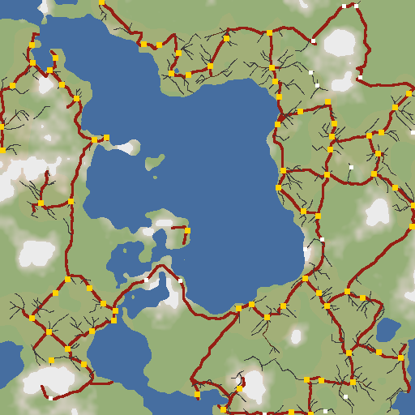
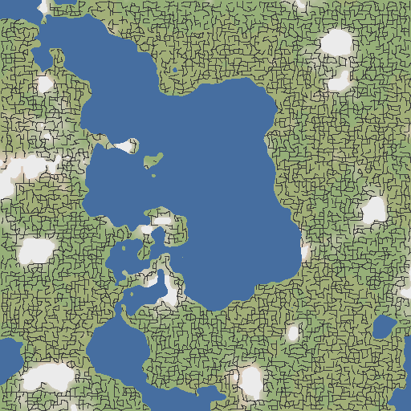
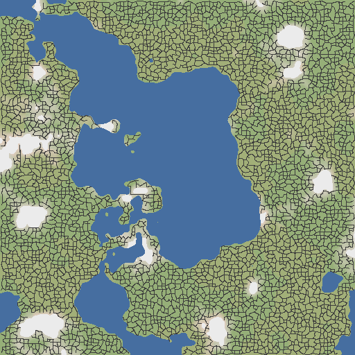

# Roads first: a local road lattice that settlements follow

John's idea (2026-10-31): decide the road network first, cell by cell, from the seed and the neighbouring cells only, prune it for sea and mountains, and let settlements follow the roads, instead of building roads between settlements that are already placed. This note checks the premise against the code, works out how such a scheme could work, compares it with today, and ends with a recommendation and a cheap next step. Item codes are glossed on first use; [GLOSSARY.md](../../GLOSSARY.md) is the lookup.

# Summary (one page)

**Is the premise right? Partly.**

- **Right:** today's roads exist only between settlements, so between two towns more than 1,536 blocks apart there is nothing, and there are no country roads in empty land. To draw the road through one chunk, the planner first has to decide every settlement within about 7 km. Each of those decisions reads exact terrain, so the cost lands on a cold start.
- **Not right: "we'd have to generate the world" and "we have to have islands".** The current graph is already local. A link between A and B depends only on settlements near A and B (the "witness" test of the relative neighbourhood graph, RNG). A chunk reads a bounded window (`RoadNet.chunkReadBound`, about 7.3 km, 160 to 220 region cells, measured), whatever the size of the network. A chain of linked towns can cross a whole continent without any chunk reading all of it.
- **What actually makes the islands** (6.10 log, 2 recorded worlds, about 150 settlements each): 9 settlements per world have no neighbour within the 1,536-block link limit (`LGAP`), and 36 to 39 have every neighbour unroutable, mostly because of water under the dry rule ([ADR 0004](../../adr/0004-roads-between-settlements.md) WR1 to WR2, no bridges over 20 blocks). So roughly a quarter of settlements are unlinked because no route works (mostly water), and 6 % because of distance. A roads-first lattice has exactly the same water: without bridges (ROADMAP 7.3, Bridges) it gets the same islands.
- **The slow spots you worked around are mostly not the road network.** On a quiet perf worker, a cold metropolis takes about 50 s for its 9 x 9 block of chunks (vanilla 2.4 s). The slowest chunk alone takes about 39 s, and that is the city's own work: the junction field (JUNCTION, street heights where streets meet) and the quay trace. The region-and-roads row is 10 to 12 s, and intercity roads were roughly half of it in an old on/off comparison ([regionperf-decision.md](../../review/regionperf-decision.md) sections 2 and 7). Roads-first could remove most of that half. It does nothing for the other 40 s.

**How it could work.** It can be made strictly local and deterministic:

```
level 2  highways    one hub per 2,048- to 4,096-block cell, at the most populous dry spot (noise only);
                     hubs linked by an RNG on cheap terrain costs; each link routed once, owner = lower key
level 1  feeders     sparse "demand" points (population noise) walk downhill on a potential that
                     falls toward highway exits; walks that meet merge for good, like streams
level 0  settlements the region planner as today (exact terrain checks), plus a road factor:
                     junctions and highway crossings raise the chance and the tier
```

- Each road decision reads only hashes, vanilla's own cheap noise (biome lookups about 4 µs, a surface estimate 6 to 28 µs, against 350 to 550 µs for an exact column), and nodes at most 2 cells away.
- Exact terrain is read only for the deck, per road segment, when the first chunk of that segment generates.
- An RNG built only from nearby edges still contains a minimum spanning tree. So **every landmass gets one connected network by construction**: this held in all 8 synthetic test worlds (section 2.8).

**What it buys:** roads everywhere on land, towns at crossroads, connectivity limited only by water, and a cold-start road cost one to two orders of magnitude lower (*estimate*). **What it doesn't:** the city-internal costs, the water islands, or a free migration. It replaces the graph half of `RoadNet`, needs a new review of the network you called "great", and adds about 4 to 6 times today's road length if the dials stay where my sketch put them.

**Recommendation.** Don't switch now, and don't let it block 0.1.0. Run a CLI prototype on the recorded 24 km worlds (S to M, no Minecraft, no heavy jobs). It draws the roads-first network in `region.html` next to today's ADR 0004 network and counts two things: how many links the cheap proxies get wrong, and how many reads it needs. That answers the sharp question in section 5. Adopt it as "roads v2" with a new ADR only if you prefer the picture and the repair rate stays under about 10 %.

# 1. Is the premise right?

## 1.1 How the current network works

- **Settlements first.** Region cells are 1,024 blocks across. Each one draws a roll and a tier from the seed, then tests 8 candidate centres on exact terrain (water share, peaks, biome suitability) ([RegionPlanner](../../../planner-core/src/main/java/dev/fractalbuildings/core/region/RegionPlanner.java)). The join rule then lets big cities claim neighbouring cells ([ADR 0003](../../adr/0003-worldgen.md) R2).
- **Then the road graph** (`RoadNet`, [ADR 0004](../../adr/0004-roads-between-settlements.md) N1): two settlements are linked when their rim gap is at most `LGAP` = 1,536 and no third settlement is closer to both. That third settlement only counts if both of its own links can be routed ("routable witnesses").
- **Then the route**: A* on the 64-block lattice, string-pulled, shaped with Catmull-Rom curves, then exact reads at every 8-block station for the dry check and the deck. A route reads 426 to 468 stations on average, 1,257 to 1,407 at p95 (6.10 log).

What one chunk's road query reads (`RoadNet.cellEdgesOf`, `scan`, `neighbours`, `edgeSet`):

```
chunk -> its region cell -> every settlement whose rim is within ~4.5 km (corridor 3 km + port + slack)
                              -> each one's neighbours within 1,536 of its rim
                                   -> witness test: both links must route (A* + exact stations)
measured: own scan 6.6-7.1 km, 160-220 region cells touched (bound 7.3 km)   [NOTES 6.10]
```

Everything is cached per cell or edge, so in steady travel each region cell is decided once. That cost is per area and roughly the same under any scheme, because district placement (`FieldSiteView`) and the village veto ask for the same cells (*inferred* from the callers listed in regionperf section 4). **The reach matters for cold starts**: teleport, spawn, a fast flight, a restart. There a disc about 7 km in radius has to be decided before the first road chunk.

## 1.2 What bounds connectedness today

| Cause | Settlements unlinked (world 12345 / 987654321, 6.10 log) | Would roads-first fix it? |
|---|---|---|
| No neighbour within `LGAP` 1,536 | 9 / 9 of 152 / 150 | Yes: the lattice runs through empty land. (Raising `LGAP` would also fix it, at a larger reach.) |
| Every neighbour unroutable (no port, no path or a failed dry check; mostly water under the dry rule, no bridge over 20) | 39 / 36 | No. The same water cuts lattice roads. Only bridges (7.3) help. |
| A routable neighbour, but unlinked | 0 / 0 | n/a: ADR 0004's guarantee holds. |

The dumps exaggerate water: every wet 64-block sample becomes a pond about 64 blocks wide. Live terrain probably links more. *Not measured.*

## 1.3 Corrections, kindly

1. "No way to connect every city because we'd have to generate the world." The network is already unbounded and local. What limits it is distance, which is a knob (`LGAP`), and water, which is a design decision (no causeways, small bridges only), not the method's locality.
2. "We need to load something about all the settlements in any given network." We load everything within about 7 km of the chunk, not the network. That is still a lot, and it is exact terrain. That part of your instinct is right, and it is the part roads-first improves.
3. "The road network is what forces the up-front planning." It forces some of it. Most of what still hurts at a cold metropolis is the city itself (junction field, quays); QUAYLAZY (lazy quay trace) and PARREADS (parallel terrain reads) are the levers there.

# 2. How a roads-first, local-only scheme could work

## 2.1 The locality rule

Every road fact must be a pure function of (seed, a fixed key, and terrain read at positions that the key alone defines). A node is keyed by its lattice cell. An edge or segment is keyed by its two node keys. If both cells beside an edge compute the edge from the same key, they agree. This holds even when they read terrain, because terrain is a pure function of position. **Agreement is never the problem; cost is.** Forbidden: anything like "the left cell saw water" (state), visit order, or reading generated blocks (ADR 0004 RD1 to RD4 carry over unchanged).

## 2.2 Lattice and cell size

- **Highway lattice: 2,048 to 4,096 blocks** (2 x 2 or 4 x 4 region cells; a dial). At 2,048, one hub per cell gives about one per 4.2 km², which matches today's settlement density on the dumps (about 150 in 600 km²), so the network would have about as many nodes as today's. The pictures use 4,096, which reads better at 49 km; with the same other settings, 2,048 gave 1.2 times the road length and almost twice the highway length in the same world (seed 7: 0.65 against 0.54 km per km² in all, highways 0.47 against 0.25).
- **Feeder lattice: 512 blocks**, half a region cell, with jittered node positions (0.7 of a cell, as `RegionField`).
- **Routing lattice: 64 blocks**, as today (`LatticePath`).

The sizes nest in the region grid, so `CellKey` arithmetic and the 64-block probes stay as they are.

## 2.3 Edges that agree

- **Node-to-node edges** with a per-edge route owned by the lower key, exactly like today's `EdgeKey` and route cache. The two ends of an edge need no "gate": the edge is one object.
- **Hashed edge gates** (a point on the shared border at `hash(seed, cell pair) ∈ [0.25, 0.75]`) are what our city skeletons already use between cells (MC1 and MC2, the Phase 5 join-rule and cities-across-cells steps; `Skeletons`). They are the right tool when each cell routes its own interior (Wang-tile style, below). The cost is forced detours: a gate on the wrong side of a lake, the reason the intercity plan rejected option (b) ([intercity-roads.md](../../plans/intercity-roads.md)).

## 2.4 Pruning for sea and mountains without breaking agreement

- **Where the sea comes from.** "Noise only" can mean vanilla's own noise. Vanilla's sea, rivers and mountains come from its climate noises: continentalness, erosion, ridges. A biome lookup reads exactly those.
- **Proxy costs** (S6, [NOTES](../../NOTES.md)):

  | Read | Cost per column | Accuracy |
  |---|---|---|
  | Biome lookup | about 4 µs | about 100 times cheaper than exact |
  | `chunk_surface_level` estimate | 6 to 28 µs | 16.5 blocks low on land |
  | Exact column | 350 to 550 µs | exact |

  Our `LiveBiomeProbe` today takes the surface height from an exact read. A topology proxy would look up the biome at a fixed height (sea level) instead, so it doesn't need that read.
- **What proxies miss:** aquifer lakes (not a biome), narrow streams, and the surface under Tectonic, where the coarse surface is 50 to 150 blocks off (S2). Ocean, river and mountain biome tags (`c:`) should hold up under biome mods (*inferred*).
- **Proposed rule:** topology (does this edge exist, roughly where does it run) from proxies. Geometry (deck, crossings, cuts) from exact reads, per segment, lazily (2.6, 3.3).
- **Pruning without losing connectivity.** Remove an edge whose proxy samples hit sea or a peak. Then run the RNG with routable witnesses over the surviving candidate edges, as ADR 0004 N1 does for settlements. Any RNG keeps every edge of the minimum spanning tree of the candidate graph, even with witnesses limited to a window. So each landmass that the candidate edges connect gets one network.

## 2.5 Coalescing: so it isn't a grid

| Technique | Look | Hierarchy | Dead ends | Connectivity | Locality (what one edge reads) | Verdict |
|---|---|---|---|---|---|---|
| Hashed edges on the lattice (bond percolation; your literal idea) | maze-like grid, even when jittered ([[docs/research/worldgen/roads-first/a-percolation.png|picture A]]) | none | many (610 to 700 per 49 km test square at p 0.7) | probabilistic: a giant component only above p = 1/2 (Kesten 1980), with fragments | the edge alone | Too grid-like; keep only as a base layer |
| Wang tiles / edge matching (each cell picks a tile matching hashed edge labels) | cell-scale tiles: straights, bends, T, cross | none | by tile choice | none beyond percolation | the cell's 4 edges | What our skeleton gates are; fine inside a cell, grid at world scale |
| Jittered gates + per-cell merge (all gates of a cell meet at 1 or 2 junctions, a small Steiner tree) | less grid; junctions become crossroads | weak | few | percolation of the gate pattern | the cell + its edges | Good feeder for settlements (a crossroads per cell); still cell-shaped |
| RNG / Gabriel graph over jittered nodes, weighted by terrain cost | cellular mesh, Voronoi-like ([[docs/research/worldgen/roads-first/b-rng.png|picture B]]) | none by itself | few (coasts) | **guaranteed per landmass** | nodes within 2 cells | Best backbone rule; too dense at one level |
| Hierarchical lattices (highways on the coarse grid, roads on the fine grid ending on them; Lost Cities) | hierarchy for free; grid if routes are straight | yes | spurs | that of the top level | 1 coarse cell | The frame; routes must bend with the terrain |
| Attractor per coarse cell (edges bend toward a hashed or most-populous point) | bundled corridors, hubs | yes | few | top level's | coarse cell + neighbours | Use it to place hubs (population maximum) |
| Drainage / flow: steepest descent on a smooth potential, walks merge (Scheidegger 1967; river networks) | dendritic, organic; can look like rivers, few loops | yes, by flow (Strahler order) | many (tips are hamlets and farms) | each walk ends at a sink; sinks on the backbone | the walk's basin (bounded when sinks are at most about 2 coarse cells apart) | Best feeder rule; needs a backbone for loops |
| Space colonisation (Runions et al. 2005) | very organic branching | yes | many | tree | global, iterative | Per-cell cache only; not needed |
| Active-walker trails and road-reuse discounts (Helbing et al. 1997; Galin et al. 2011) | realistic trunk sharing | yes | few | given by the graph | sequential, global | Explains merging; not chunk-local. Galin's RNG over routed costs (their γ → ∞) is what ADR 0004 already does |
| Tensor fields (Chen et al. 2008) | contour-following, organic | weak | few | none | streamline tracing, long range | Inside cities or per cell only; the [[docs/research/pcg/tensor-field-streets|existing note]] says the same |
| L-system growth (Parish and Müller 2001) | city-like growth toward population | yes | some | grows from seeds | sequential | Not local; borrow its snap-to-nearby-road merge rule |

**Merging rules that stay local:**

- A feeder walk that comes within one fine cell of another walk's node joins it. Walks are deterministic from their start, so once two meet they coincide, and order cannot matter.
- An edge whose route runs within about 64 blocks of a stronger road for most of its length is dropped in favour of a junction (a local, Fréchet-like test over the routes in the band).
- Spurs ending without a settlement are pruned for k rounds, with a fixed k. Unbounded pruning would not be local.

## 2.6 The design I'd prototype

1. **Hubs:** in each highway cell, the feeder node with the highest population noise (plus a hash tie-break). No hub if the cell has no dry land or its population is under a threshold.
2. **Highways:** an RNG over the hubs within 2 cells, weighted by a proxy route cost (A* on the 64-block lattice over biome and surface proxies; sea and peaks forbidden). Routes are cached per edge, owned by the lower key (today's code).
3. **Exits:** hubs, plus hashed points along highways (about one per 1.5 to 3 km; the picture used far fewer, about one per 8 to 10 km, which makes feeders longer).
4. **Feeders:** demand points (feeder nodes where population noise is high, thinned by a hash) walk down a potential: the distance to the nearest exit, raised on hills, plus smooth noise for meanders. Flow (how many walks share an edge) gives the class (track, lane, road).
5. **Segments:** each route is cut at fixed knots every 256 blocks. The first chunk that touches a segment reads that segment's exact stations (about 32 reads, 15 ms), then builds its deck, crossings and cuts with today's `Profile` and terrace code. The deck at a knot is the mean of the stations within ±64 of the knot, so neighbouring segments meet at the same height. A wet run over 20 blocks gets a local detour inside the segment's band, with its knots fixed. If no detour is found, the road ends at both shores. The prototype counts how often that happens.



*Picture C:* synthetic noise world, 49 km square, 1 pixel = 96 blocks, seed 7, hubs every 4,096 blocks, feeder lattice 512. Blue is sea, white peaks, the paler green higher population. Red highways run between gold hubs; thin lines are feeders. It comes from a throwaway node script (no Minecraft, nothing merged), so it shows topology, not real terrain.

## 2.7 Settlements from roads

The region planner keeps everything that makes cities sit well (exact water, peak and suitability checks, the join rule). It gains three inputs from the road layer, which is cheap and local, so the join rule's exact reads don't widen:

- **Candidates:** the junctions and hubs in the cell join the 8 hashed candidate centres, so crossroads and highway crossings get tried first.
- **Chance:** `baseChance x suitability x roadFactor`, where `roadFactor` grows with the best road class in the cell and its junction count (roughly 0.5 with no road, up to 1.5 at a highway junction; *constants to tune*). The population noise that places hubs and demand points is what makes road density and settlement density go together. That covers your "dense road areas become cities" without a separate rule.
- **Tier:** the seeded tier draw (`Tiers.tier`) keeps its hash, but its weights shift toward town and up at highway junctions and toward hamlet off the network. The metropolis Pareto tail is unchanged.

A settlement with no road nearby either stays a lone hamlet, or gets a spur to the nearest road node through today's approach code (`LinkExits`). The spur belongs to the settlement, so roads never read settlements. Every road that crosses a footprint rim becomes a required exit. Inside the rim, the city's own streets take over (ownership rule D5).

## 2.8 What connectedness you get

Throwaway simulation over 8 synthetic seeds. The world is 49 km square with about 67 % land, a 512-block fine lattice and edges pruned on 128-block chord samples. Coverage counts the demand points that lie within one fine cell of their landmass's largest network. A "landmass" is what the 8-neighbour dry lattice can connect.

| Scheme | Road km per km² of land | Demand points by their landmass's main network (min to max over 8 seeds) | Dead ends per seed | Notes |
|---|---|---|---|---|
| A, hashed lattice edges, p 0.5 | 1.9 | 18 to 37 % | 1,716 (seed 7) | at the percolation threshold |
| A, p 0.6 | 2.3 | 70 to 99 % | 1,126 (seed 7) | swings by seed: near the threshold, terrain decides |
| A, p 0.7 | 2.7 | 97 to 99.9 % | 610 to 700 | 30 to 39 separate road pieces |
| B, RNG over all nodes | 2.6 | 99.9 to 100 % | 184 to 283 | exactly one network per landmass in all 8 seeds |
| C, hierarchy (hubs every 4,096 blocks) | 0.5 to 0.6 (highways 0.25 to 0.33) | 88 to 91 % | 251 to 346 | the misses are coverage (only 15 % of demand points send a feeder); highways are B-connected |

For scale, today's network on the recorded worlds is about 0.1 km of road per km² (73 routes of mean 0.9 km in 600 km²). C as tuned would have 4 to 6 times today's road length; the lattice sizes are the dial. The remaining islands are water, as today. Sources: the 6.10 log for today's numbers; the script is kept as a forensic copy (not tracked) in `.claude/reports/research-roadsfirst-sim.mjs`.





*Pictures A and B:* the same world as picture C. Both are far denser than C because every 512-block node is a road node; what to look at is the shape: a maze for A, a cellular mesh for B. Neither has hierarchy on its own.

# 3. Costs and risks

## 3.1 Cost compared with today

| Work | Today (ADR 0004) | Roads-first (sketch) |
|---|---|---|
| Inputs to road topology | exact decisions of 160 to 220 region cells within about 7 km (about 11 ms per cell by an early live figure in the intercity plan; SKIPROLL, which skips terrain reads for cells that can never settle, skips about 35 % of cells) | hashes and noise for hubs within 2 coarse cells; no settlement decisions |
| Routing | A* on the 64 lattice over exact single columns (1,259 to 1,507 node requests per route on average, many repeats, memoised; 0.35 to 0.55 ms per new column; up to 40 to 100 ms per cell, ADR 0004 *estimate*) | the same A* over proxies (about 30 µs per node) |
| Dry check and deck | about 450 exact stations per route, up front, before the edge may exist | about 32 per 256-block segment, only when a chunk in it generates |
| Warm road chunk | about 0.3 ms of writes | the same |
| City-internal work (junction field, quays) | most of the cold 9 x 9 block at a metropolis (its slowest chunk, about 39 s of 50 s) | unchanged |

Net (*estimate, not measured*): the road share of a cold warm, roughly half of the 10 to 12 s region row, drops one to two orders of magnitude. The settlement decisions for the city's own cells stay. Cold arrival might go from about 70 s to about 60 to 65 s. Per area in steady exploration it changes little: region cells are decided once either way. More road gets drawn, though: at 4 to 6 times the length, 4 to 6 times as many road chunks pay the cold deck reads (about 7 ms each, ADR 0004 option 3b).

## 3.2 Determinism and chunk order

The scheme has no new kind of risk: pure functions of keys, strict tie-breaks by key (ADR 0004 RD2), caches that only memoise (RD3), and `StrictMath` curves. New things to guard:

- the fixed-height biome lookup still needs the priming rule (ADR 0003 D3);
- the surface estimate needs an accessor to vanilla's private router (S6 used reflection);
- segment repair must depend on its segment only, which the shuffled-order and capacity-1 tests of `RoadNetTest` already exercise.

## 3.3 Roads meeting terrain when topology comes from proxies

- **Water the proxy missed:** a crossing of up to 20 blocks (WR2) as today, a local detour inside the segment, or a broken road with dead ends on both shores. With bridges on (7.3), a real bridge.
- **Slopes:** the grade-limited deck and the terraced cuts (TC) as today. A proxy that is 16 blocks low, or 50 to 150 under Tectonic, chooses worse valleys but never sets a deck height. The deck is always exact (ADR 0004 HT).
- **Mountains:** peaks pruned by biome or surface estimate. No switchbacks: a segment steeper than the grade limit is detoured or cut.

## 3.4 Cities meeting the incoming roads

This is mostly existing code:

- rim crossings become required exits (`LinkExits`, with the ports coming from the crossings instead of from link bearings);
- main roads run from the exits to the hub (skeleton);
- exits with nothing beyond still end where the town does (MAINSTUB, main roads that end at a gate);
- roads bend around vanilla villages (VILLROAD).

The new part: a city now gets roads from several directions it didn't choose, and a metropolis 3 km wide gets many of them. Its arterials should line up with the strongest incoming roads. That is a Phase 7 design item.

## 3.5 What gets worse

- **Bad spots and ghost junctions:** a highway junction on a slope that the planner then rejects leaves a crossroads with no town. That is fine at a few, odd at many.
- **Odd hierarchy:** a highway linking two hamlets, or a small lane into a metropolis. This needs class from population noise at both ends, the same noise the settlement tiers lean on.
- **Strip towns:** settlements bunched along highways. That is realistic but repetitive. A hash spacing rule (as in the sketch) limits it.
- **More road, more blocks, more feature time**, and more road crossing vanilla structures.
- **Review and migration:** the network you reviewed changes everywhere, along with the gate fixtures' links and a `genVersion` bump. ADR 0004's guarantee ("every settlement with a routable neighbour within 1,536 is linked") becomes "every landmass has one network, and settlements join it by exits or spurs".

# 4. Reuse

| Area | Fate | Notes |
|---|---|---|
| Buildings: `gen`, `grammar`, `ir`, `raster`, `voxel`, `style`, `check` | **kept as is** | all building rules |
| `settlement` (69 files, about 10.9k lines: skeleton, districts, streets, junction field, quays, lots, briefs) | **kept** | `LinkExits` changes its port source; skeleton exits unchanged |
| `region` (`RegionField`, join rule, `Tiers`, `BiomeClass`) | **kept**, small change | `RegionPlanner.decide` gains a road factor and junction candidates |
| `road` (8 files, 2.2k lines) | **about two thirds kept** | replaced: `RoadNet`'s settlement graph, ports and witness search (about 400 of its 822 lines). Kept: EdgeKey ownership, the route cache, `LatticePath` A*, `Curve`, `Profile` (dry check, crossings, deck), raster, `RoadMaterials`, `RoadSurface`, `VillageJoin`, `RoadJson` (the viewer's road layer reads it unchanged) |
| `world/WorldPlanner` | changed | `warm` no longer needs region decisions to warm roads; `roadColumns` keeps its API |
| `mod` | small additions | `RoadFeature` and the probes stay; add a fixed-height biome probe and a surface-estimate probe |
| `viewer` | kept | `region.html` already draws `RoadJson` |
| Tests | patterns kept | order and capacity tests reused; the N1 orphan test becomes a landmass-connectivity test |

New code: a lattice/hub layer, the feeder walk, the segment cache and repair, and the region planner's road factor. That is roughly M to L for a coder.

# 5. Recommendation and the cheap next step

**Recommendation: not now, and not instead of the 0.1.0 work.** The scheme is sound: local, deterministic, and connected per landmass by construction. But the cost it removes is the smaller part of the cold-arrival problem, it doesn't remove the water islands, and it reopens a reviewed design. Decide after a prototype, as Phase 7 or later.

**Spike (S to M, CLI and viewer only, no Minecraft, no heavy jobs):** a throwaway `roadsfirst` CLI command on a spike branch, over `fixtures/terrain/world-12345-s64` and `world-987654321-s64` (24.5 km square each).

- It builds design 2.6, using the dump's biome as the topology proxy and its exact water and floor as the truth for the segments.
- It writes a `roads` layer in the existing `RoadJson` format, next to today's network for the same window, for `region.html`.
- It reports:
  - share of today's settlements on or within 256 blocks of the network;
  - segments needing a detour, and segments cut, where proxy and truth disagree;
  - reads per km² (proxy and exact) against `fractal-cli roads`;
  - road km per km²;
  - an order-shuffle check.

**The sharp question:** on real terrain, can a network decided from (seed, cell, neighbours) and cheap proxies only reach at least today's linked share with under about 10 % of segments needing repair, and do you prefer how it looks to ADR 0004's network?

- No on repair, or no on looks: drop it, and raise `LGAP` instead for the 6 % that distance cuts off.
- Yes on both: a second step dumps live proxies (fixed-height biome and the surface estimate) beside exact columns from a real world, to check the proxy under Terralith and Tectonic. Then an ADR superseding parts of ADR 0004.

**The strongest case for switching anyway:** if what you want most is the travel feel (a road out of every town that leads somewhere, country roads, inns at crossroads, a continent you can ride across), settlement-first can't give it. Raising `LGAP` only stretches links between towns; it never creates roads through empty land. Roads-first also makes the road layer independent of the most expensive decisions we make.

**What would change my mind:**

- measuring that roads, not the city, dominate cold arrival once QUAYLAZY and the junction work land;
- you saying wilderness roads matter more than the reviewed network;
- the proxy repair rate coming out low, under 5 %, which would make roads-first cheap and safe.

# Sources

**Licences:**

- **Lost Cities: MIT.** Studied in [lost-cities-road-planning.md](../overlays/lost-cities-road-planning.md): hierarchical hashed street grid, and highway hubs per cell with mutual selection.
- **Papers (ideas only, no code):**
  - Galin, Peytavie, Guérin, Beneš, "Authoring Hierarchical Road Networks", CGF 30(7) 2011 ([PDF](https://www.cs.purdue.edu/homes/bbenes/papers/Galin11CGF.pdf)). I read sections 3 to 6: three levels; a proximity graph with parameter γ (γ → ∞ is the RNG, γ = 2 the Gabriel graph) over routed, terrain-aware costs; path merging by Fréchet distance; global and sequential, 89 to 147 s per scene on a 256 x 256 grid.
  - Parish and Müller 2001, and Chen et al. 2008: see the existing notes ([parish-muller](../pcg/parish-muller-cities.md), [tensor fields](../pcg/tensor-field-streets.md)).
  - From memory, not re-read for this note: Kesten 1980, "The critical probability of bond percolation on the square lattice equals 1/2" (Comm. Math. Phys. 74); Scheidegger 1967, the random drainage-network model; Runions et al. 2005, leaf venation (space colonisation); Helbing et al. 1997, the active walker trail model; Cohen et al. 2003, Wang tiles.
- **Countered's Settlement Roads** (Minecraft mod, roads between villages): the GitHub page says CC0-1.0, aggregators say MIT. I did not read its code, so its method is unknown.

**From this repo:**

- [ADR 0004](../../adr/0004-roads-between-settlements.md), [ADR 0003](../../adr/0003-worldgen.md), [ARCHITECTURE](../../ARCHITECTURE.md);
- [regionperf-decision.md](../../review/regionperf-decision.md) sections 2, 4, 7 and 8, and the explainer (`docs/review/explainer/index.html`);
- [intercity-roads plan](../../plans/intercity-roads.md) (option (c) there is a crude roads-first, rejected for grid look and ignoring terrain);
- the [6.10 log](../../log/2026-10-23-p6-610-roads.md) and [NOTES](../../NOTES.md) (6.10 read bound, S6 probe costs);
- code: `road/RoadNet.java` (graph, scan, cell edges), `region/RegionField.java`, `region/Tiers.java`, `world/WorldConfig.java`, `settlement/LinkExits.java`, `Arterials.java`, `Skeletons.java` (class docs).

**What I couldn't verify:**

- No Minecraft was run.
- The proxy costs are S6's (about 4 µs biome, 6 to 28 µs surface); I didn't re-measure them.
- The proxy miss rate on real terrain is the spike's job.
- The "roads are about half the region row" share comes from an old on/off comparison on a busy host. No current figure exists.
- Every cost in 3.1 is an estimate.
- The simulation is synthetic noise, not Minecraft terrain. It shows topology and connectivity only, and its settlement scoring is a toy.
