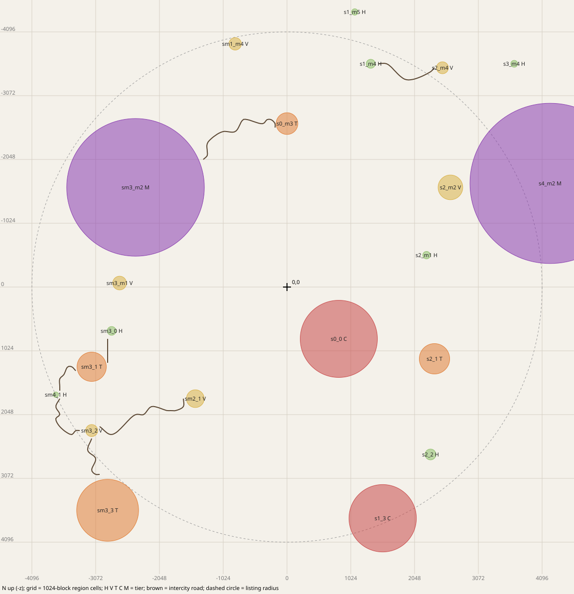
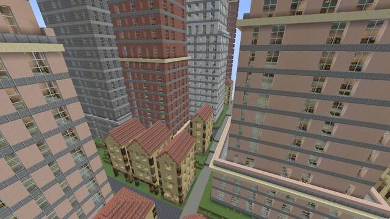
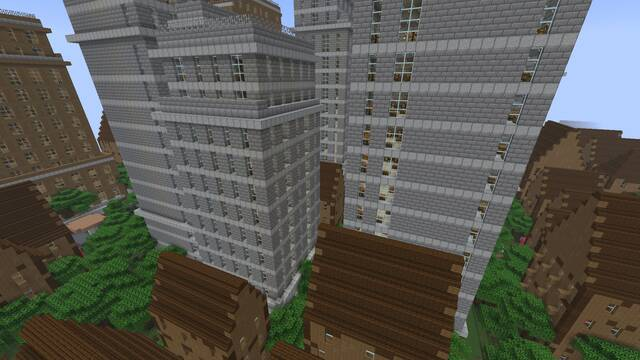
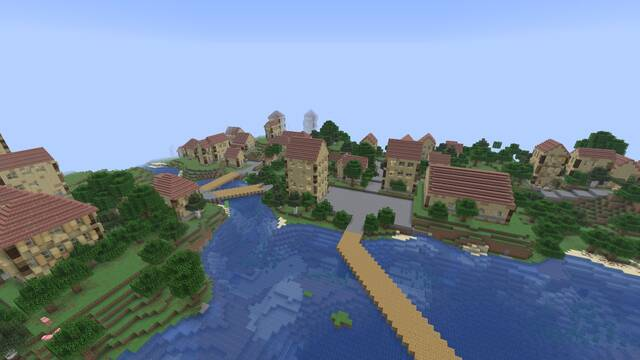
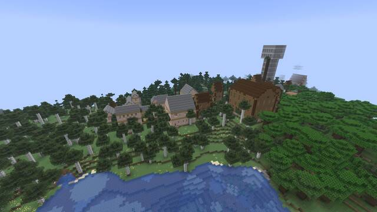
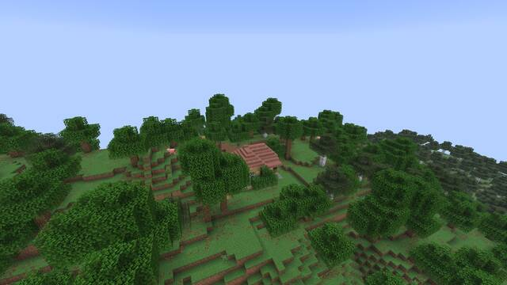
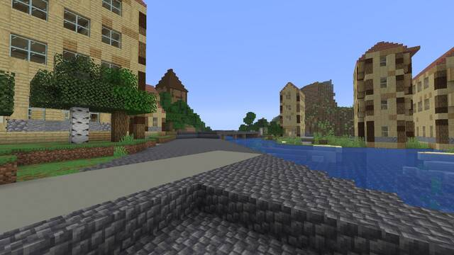

# Seed 1573336981619055086

John's playtest world of 2026-10-28 (notes: docs/review/phase6/playtest-2026-10-28)

Generated by `scripts/playtest-kit.sh` at commit `cca366564c` from an offline plan of this seed (terrain dump at 64-block
steps, the same columns the game's region layer reads, then `fractal-cli roads`). The game should agree; check with
`/fb locate` at spawn (table below). Distances and directions are from 0,0: your spawn point is usually within a few
hundred blocks of it (F3 shows where you are).

# World creation

1. Singleplayer, Create New World, game mode of your choice (Creative makes `/tp` and flying easy; allow commands).
2. More World Options: seed `1573336981619055086`, world type Default, Generate Structures ON.
3. Create. The first chunks around spawn can take a while.

# `/fb locate` at spawn should say

| Command | Settlement | Centre | Distance from 0,0 |
|---|---|---|---|
| `/fb locate hamlet` | s0_0 (city, radius 619) | 832, 832 | 1,177 SE |
| `/fb locate village` | s0_0 (city, radius 619) | 832, 832 | 1,177 SE |
| `/fb locate town` | s0_0 (city, radius 619) | 832, 832 | 1,177 SE |
| `/fb locate city` | s0_0 (city, radius 619) | 832, 832 | 1,177 SE |
| `/fb locate metropolis` | sm3_m2 (metropolis, radius 1105) | -2432, -1600 | 2,911 NW |

`/fb locate` searches 8 region cells (about 8 km) around you and gives a settlement's centre; a different answer means the offline plan and the game disagree (worth an FBNOTE).

# Settlements within 4,096 blocks of 0,0



| # | Id | Tier | Centre x, z | Radius | Distance, direction | Biome mix (% of footprint) | Port | Road links | Teleport |
|---|---|---|---|---|---|---|---|---|---|
| 1 | s0_0 | city | 832, 832 | 619 | 1,177 SE | temperate 63, water 25, savanna 12 | yes |  | `/tp @s 832 ~ 832` |
| 2 | s2_m1 | hamlet | 2240, -512 | 60 | 2,298 E | temperate 100 |  |  | `/tp @s 2240 ~ -512` |
| 3 | sm2_1 | village | -1472, 1792 | 142 | 2,319 SW | taiga 46, temperate 46, water 8 |  | 1 | `/tp @s -1472 ~ 1792` |
| 4 | s0_m3 | town | 0, -2624 | 174 | 2,624 N | temperate 89, water 11 | yes | 1 | `/tp @s 0 ~ -2624` |
| 5 | s2_1 | town | 2368, 1152 | 244 | 2,633 SE | temperate 71, savanna 24 | yes |  | `/tp @s 2368 ~ 1152` |
| 6 | sm3_m1 | village | -2688, -64 | 110 | 2,689 W | temperate 100 |  |  | `/tp @s -2688 ~ -64` |
| 7 | sm3_0 | hamlet | -2816, 704 | 70 | 2,903 W | temperate 100 |  | 1 | `/tp @s -2816 ~ 704` |
| 8 | sm3_m2 | metropolis | -2432, -1600 | 1105 | 2,911 NW | temperate 80, water 12, mountain 8 |  | 1 | `/tp @s -2432 ~ -1600` |
| 9 | s2_m2 | village | 2624, -1600 | 198 | 3,073 NE | temperate 97 |  | 1 | `/tp @s 2624 ~ -1600` |
| 10 | sm3_1 | town | -3136, 1280 | 235 | 3,387 W | temperate 72, mountain 20 |  | 2 | `/tp @s -3136 ~ 1280` |
| 11 | s2_2 | hamlet | 2304, 2688 | 87 | 3,540 SE | temperate 100 |  |  | `/tp @s 2304 ~ 2688` |
| 12 | s1_m4 | hamlet | 1344, -3584 | 72 | 3,828 N | temperate 100 |  | 1 | `/tp @s 1344 ~ -3584` |
| 13 | sm3_2 | village | -3136, 2304 | 97 | 3,891 SW | temperate 78, jungle 22 |  | 3 | `/tp @s -3136 ~ 2304` |
| 14 | sm1_m4 | village | -832, -3904 | 100 | 3,992 N | temperate 100 |  |  | `/tp @s -832 ~ -3904` |
| 15 | s1_3 | city | 1536, 3712 | 541 | 4,017 S | temperate 88, water 10 |  |  | `/tp @s 1536 ~ 3712` |
| 16 | sm4_1 | hamlet | -3712, 1728 | 43 | 4,094 SW | temperate 100 |  | 2 | `/tp @s -3712 ~ 1728` |

The teleport keeps your height (`~`); in Survival use Creative or Spectator first, or replace `~` with a height. A long teleport
into unvisited land is held until the destination is generated (an action-bar message says so; up to 30 s).

# Road links to follow

Intercity roads leave a settlement at an exit and end at the other one's exit. Teleport to the start exit and walk.

| From | To | Road length | Start exit (x, z) | End exit (x, z) | Start here |
|---|---|---|---|---|---|
| sm2_1 (village) | sm3_2 (village) | 1,730 | -1664, 1792 | -3008, 2240 | `/tp @s -1664 ~ 1792` |
| s0_m3 (town) | sm3_m2 (metropolis) | 1,689 | -192, -2560 | -1344, -2048 | `/tp @s -192 ~ -2560` |
| sm3_0 (hamlet) | sm3_1 (town) | 384 | -2880, 832 | -2880, 1216 | `/tp @s -2880 ~ 832` |
| s2_m2 (village) | s4_m2 (metropolis) | touching | 2880, -1610 | 2880, -1610 | `/tp @s 2880 ~ -1610` |
| sm3_1 (town) | sm4_1 (hamlet) | 587 | -3392, 1344 | -3648, 1664 | `/tp @s -3392 ~ 1344` |
| s1_m4 (hamlet) | s2_m4 (village) | 1,048 | 1472, -3584 | 2368, -3520 | `/tp @s 1472 ~ -3584` |
| sm3_2 (village) | sm4_1 (hamlet) | 924 | -3328, 2304 | -3648, 1792 | `/tp @s -3328 ~ 2304` |
| sm3_2 (village) | sm3_3 (town) | 755 | -3136, 2432 | -3008, 3008 | `/tp @s -3136 ~ 2432` |

# A short route for the first hour

Walking is about 4.3 blocks a second (sprint 5.6), so 1,000 blocks is about 4 minutes.

1. walk from spawn to s0_0 (city, centre 832, 832): about 1,177 blocks.
2. teleport (or walk overland; no road from s0_0) to sm2_1 (village, centre -1472, 1792): about 2,496 blocks.
3. follow the road to sm3_2 (village, centre -3136, 2304): about 1,730 blocks; road starts at -1664, 1792.
4. follow the road to sm3_3 (town, centre -2880, 3584): about 755 blocks; road starts at -3136, 2432.
5. teleport or elytra to sm3_m2 (metropolis, centre -2432, -1600): about 5,203 blocks.

In each: walk the main street to the centre, go into a few buildings (upstairs too), sleep in a bed, open a chest.

# Fly-through frames

Shot by `scripts/flythrough.sh` (commit `6ea46a6708`), downscaled. The teleport puts you where the camera stood.



metropolis sm3_m2 (centre -2432,-1600), sweep-a: `/tp @s -2451.1 110.8 -1499.8 -112.5 24.0`



city s0_0 (centre 832,832), sweep-a: `/tp @s 1016.8 110.7 834.4 -22.5 24.0`



town s0_m3 (centre 0,-2624), view: `/tp @s 80.6 105.2 -2635.2 67.5 24.0`



village sm2_1 (centre -1472,1792), view: `/tp @s -1552.1 109.2 1728.3 -67.5 24.0`



hamlet s2_m1 (centre 2240,-512), view: `/tp @s 2245.9 116.0 -571.5 22.5 24.0`



metropolis sm3_m2 (centre -2432,-1600), street: `/tp @s -2242.5 64.4 -1660.5 -124.8 -1.4`

# Offline road report

```
seed 1573336981619055086: 41 settlements {city=4, hamlet=16, metropolis=2, town=7, village=12}, 8 tagged port
linked 24 of 41 = 58.5 %; unlinked: 4 with no neighbour within 1536, 13 with every neighbour unroutable, 0 with a routable neighbour (must be 0)
links: 14 routed + 2 meeting points (touching), 33 pairs dropped by the dry check or no path {dry check failed after N reroutes: wet run N=3, no dry reroute=7, no path=14, no port=9}
centre-to-centre per 500: 0: 1, 500: 5, 1000: 2, 1500: 5, 2500: 1
route length mean / p50 / p95 / max: 846.9 / 922.0 / 1727.0 / 1727.0
max deck grade per route mean / p50 / p95 / max: 0.2 / 0.3 / 0.5 / 0.5
crossings: 10 on 6 of 14 routes; wet run length per 4: 0: 6, 4: 1, 8: 2, 16: 1; 4 routes rerouted; 46176 road columns
exact station reads per route mean / p50 / p95 / max: 292.8 / 266.0 / 687.0 / 687.0
lattice node requests per route mean / p50 / p95 / max: 686.6 / 476.0 / 1391.0 / 1391.0
route time ms mean / p50 / p95 / max: 25.7 / 16.6 / 176.5 / 176.5
lattice nodes read from the coarse probe: 5240; routes built: 52 (incl. witnesses and dropped); all of it in 0.8 s
```
