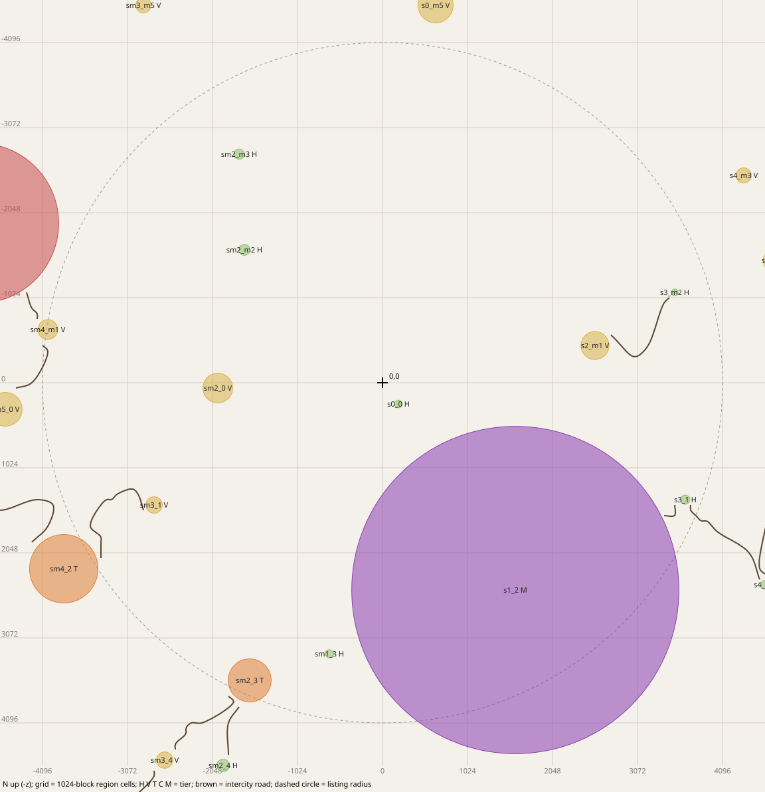
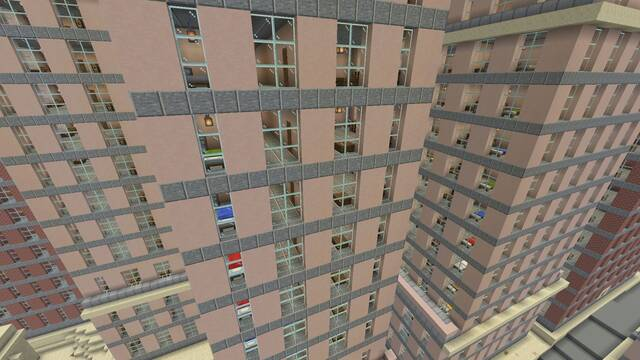
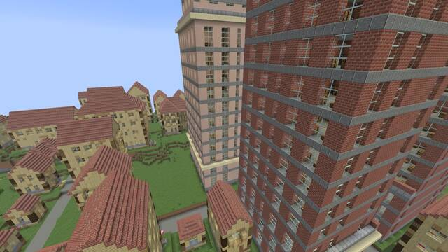
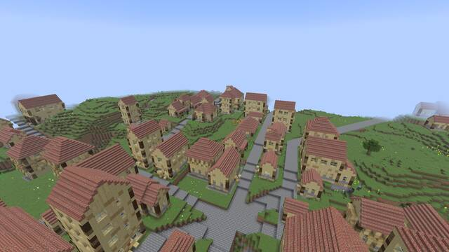
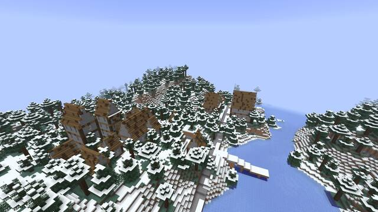
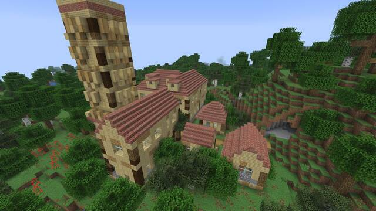
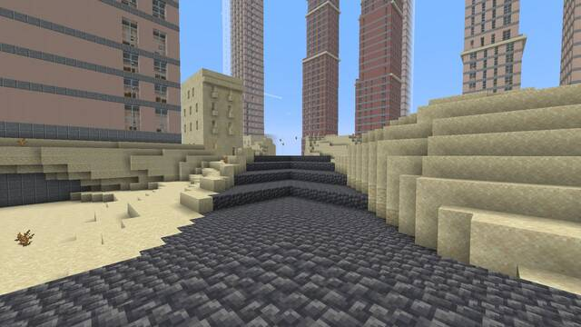

# Seed 1709797029209580947

John's playtest world of 2026-10-26 (notes: docs/review/phase6/playtest-comments)

Generated by `scripts/playtest-kit.sh` at commit `cca366564c` from an offline plan of this seed (terrain dump at 64-block
steps, the same columns the game's region layer reads, then `fractal-cli roads`). The game should agree; check with
`/fb locate` at spawn (table below). Distances and directions are from 0,0: your spawn point is usually within a few
hundred blocks of it (F3 shows where you are).

# World creation

1. Singleplayer, Create New World, game mode of your choice (Creative makes `/tp` and flying easy; allow commands).
2. More World Options: seed `1709797029209580947`, world type Default, Generate Structures ON.
3. Create. The first chunks around spawn can take a while.

# `/fb locate` at spawn should say

| Command | Settlement | Centre | Distance from 0,0 |
|---|---|---|---|
| `/fb locate hamlet` | s0_0 (hamlet, radius 46) | 192, 256 | 320 SE |
| `/fb locate village` | sm2_0 (village, radius 179) | -1984, 64 | 1,985 W |
| `/fb locate town` | s1_2 (metropolis, radius 1970) | 1600, 2496 | 2,965 SE |
| `/fb locate city` | s1_2 (metropolis, radius 1970) | 1600, 2496 | 2,965 SE |
| `/fb locate metropolis` | s1_2 (metropolis, radius 1970) | 1600, 2496 | 2,965 SE |

`/fb locate` searches 8 region cells (about 8 km) around you and gives a settlement's centre; a different answer means the offline plan and the game disagree (worth an FBNOTE).

# Settlements within 4,096 blocks of 0,0



| # | Id | Tier | Centre x, z | Radius | Distance, direction | Biome mix (% of footprint) | Port | Road links | Teleport |
|---|---|---|---|---|---|---|---|---|---|
| 1 | s0_0 | hamlet | 192, 256 | 46 | 320 SE | temperate 100 |  |  | `/tp @s 192 ~ 256` |
| 2 | sm2_0 | village | -1984, 64 | 179 | 1,985 W | snow 81, water 14 |  |  | `/tp @s -1984 ~ 64` |
| 3 | sm2_m2 | hamlet | -1664, -1600 | 66 | 2,308 NW | temperate 100 |  |  | `/tp @s -1664 ~ -1600` |
| 4 | s2_m1 | village | 2560, -448 | 169 | 2,599 E | snow 100 |  | 1 | `/tp @s 2560 ~ -448` |
| 5 | s1_2 | metropolis | 1600, 2496 | 1970 | 2,965 SE | desert 55, water 31, swamp 14 | yes | 1 | `/tp @s 1600 ~ 2496` |
| 6 | sm3_1 | village | -2752, 1472 | 99 | 3,121 SW | mountain 89, snow 11 |  | 1 | `/tp @s -2752 ~ 1472` |
| 7 | sm2_m3 | hamlet | -1728, -2752 | 62 | 3,250 NW | temperate 100 |  |  | `/tp @s -1728 ~ -2752` |
| 8 | sm1_3 | hamlet | -640, 3264 | 49 | 3,326 S | temperate 100 |  |  | `/tp @s -640 ~ 3264` |
| 9 | s3_m2 | hamlet | 3520, -1088 | 41 | 3,684 E | temperate 100 |  | 1 | `/tp @s 3520 ~ -1088` |
| 10 | s3_1 | hamlet | 3648, 1408 | 55 | 3,910 E | temperate 100 |  | 2 | `/tp @s 3648 ~ 1408` |
| 11 | sm2_3 | town | -1600, 3584 | 259 | 3,925 SW | temperate 62, savanna 15, shore 15 | yes | 2 | `/tp @s -1600 ~ 3584` |
| 12 | sm4_m1 | village | -4032, -640 | 119 | 4,082 W | taiga 89, mountain 11 |  | 2 | `/tp @s -4032 ~ -640` |

The teleport keeps your height (`~`); in Survival use Creative or Spectator first, or replace `~` with a height. A long teleport
into unvisited land is held until the destination is generated (an action-bar message says so; up to 30 s).

# Road links to follow

Intercity roads leave a settlement at an exit and end at the other one's exit. Teleport to the start exit and walk.

| From | To | Road length | Start exit (x, z) | End exit (x, z) | Start here |
|---|---|---|---|---|---|
| s2_m1 (village) | s3_m2 (hamlet) | 1,253 | 2752, -576 | 3456, -1024 | `/tp @s 2752 ~ -576` |
| s1_2 (metropolis) | s3_1 (hamlet) | 262 | 3392, 1600 | 3520, 1472 | `/tp @s 3392 ~ 1600` |
| sm3_1 (village) | sm4_2 (town) | 1,483 | -2880, 1536 | -3392, 2112 | `/tp @s -2880 ~ 1536` |
| s3_1 (hamlet) | s4_2 (hamlet) | 1,306 | 3712, 1472 | 4544, 2368 | `/tp @s 3712 ~ 1472` |
| sm2_3 (town) | sm3_4 (village) | 1,098 | -1856, 3776 | -2496, 4416 | `/tp @s -1856 ~ 3776` |
| sm2_3 (town) | sm2_4 (hamlet) | 619 | -1728, 3904 | -1856, 4480 | `/tp @s -1728 ~ 3904` |
| sm4_m1 (village) | sm5_m2 (city) | 359 | -4160, -768 | -4288, -1088 | `/tp @s -4160 ~ -768` |
| sm4_m1 (village) | sm5_0 (village) | 736 | -4096, -448 | -4416, 64 | `/tp @s -4096 ~ -448` |

# A short route for the first hour

Walking is about 4.3 blocks a second (sprint 5.6), so 1,000 blocks is about 4 minutes.

1. walk from spawn to sm2_0 (village, centre -1984, 64): about 1,985 blocks.
2. teleport (or walk overland; no road from sm2_0) to sm3_1 (village, centre -2752, 1472): about 1,604 blocks.
3. follow the road to sm4_2 (town, centre -3840, 2240): about 1,483 blocks; road starts at -2880, 1536.
4. teleport or elytra to s1_2 (metropolis, centre 1600, 2496): about 5,446 blocks.

In each: walk the main street to the centre, go into a few buildings (upstairs too), sleep in a bed, open a chest.

# Fly-through frames

Shot by `scripts/flythrough.sh` (commit `6ea46a6708`), downscaled. The teleport puts you where the camera stood.



metropolis s1_2 (centre 1600,2496), sweep-a: `/tp @s 1442.7 117.8 2091.4 22.5 24.0`



city sm5_m2 (centre -4864,-1920), sweep-a: `/tp @s -5319.2 105.6 -2046.9 -157.5 24.0`



town sm2_3 (centre -1600,3584), view: `/tp @s -1626.2 112.2 3664.9 -22.5 24.6`



village sm2_0 (centre -1984,64), view: `/tp @s -1975.3 118.2 15.6 157.5 24.0`



hamlet s0_0 (centre 192,256), view: `/tp @s 182.6 85.4 228.9 -22.5 24.0`



metropolis s1_2 (centre 1600,2496), street: `/tp @s 1487.5 74.4 2447.5 135.0 2.2`

# Offline road report

```
seed 1709797029209580947: 49 settlements {city=2, hamlet=19, metropolis=1, town=7, village=20}, 8 tagged port
linked 29 of 49 = 59.2 %; unlinked: 0 with no neighbour within 1536, 20 with every neighbour unroutable, 0 with a routable neighbour (must be 0)
links: 20 routed + 0 meeting points (touching), 50 pairs dropped by the dry check or no path {dry check failed after N reroutes: wet run N=7, dry check failed, nothing left to ban: wet run N=1, no dry reroute=12, no path=17, no port=13}
centre-to-centre per 500: 500: 4, 1000: 12, 1500: 3, 2000: 1
route length mean / p50 / p95 / max: 797.1 / 874.0 / 1481.0 / 1481.0
max deck grade per route mean / p50 / p95 / max: 0.2 / 0.3 / 0.3 / 0.3
crossings: 6 on 5 of 20 routes; wet run length per 4: 0: 2, 4: 2, 8: 1, 16: 1; 8 routes rerouted; 54532 road columns
exact station reads per route mean / p50 / p95 / max: 426.7 / 244.0 / 1315.0 / 1315.0
lattice node requests per route mean / p50 / p95 / max: 1117.1 / 888.0 / 3415.0 / 3415.0
route time ms mean / p50 / p95 / max: 15.2 / 7.0 / 127.7 / 127.7
lattice nodes read from the coarse probe: 7429; routes built: 71 (incl. witnesses and dropped); all of it in 0.8 s
```
