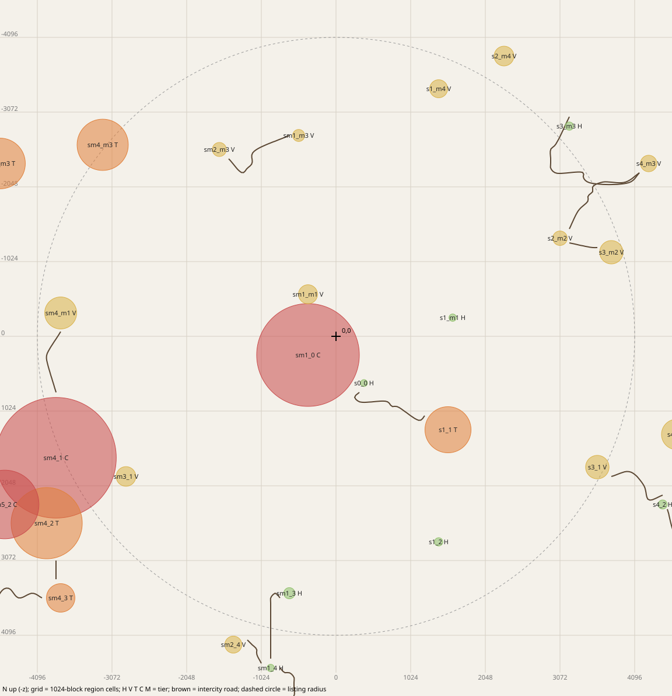
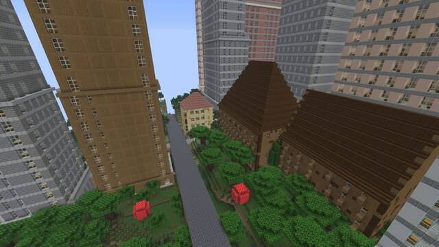
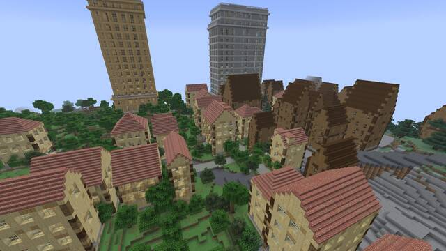
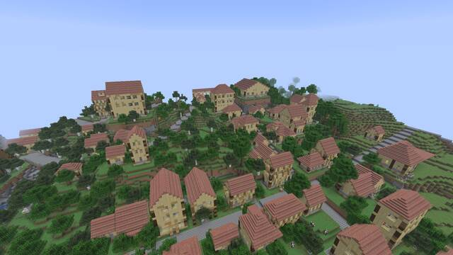
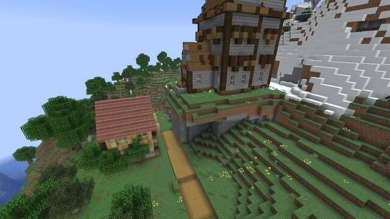
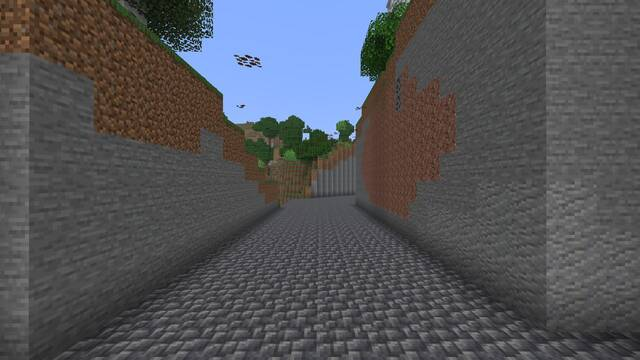
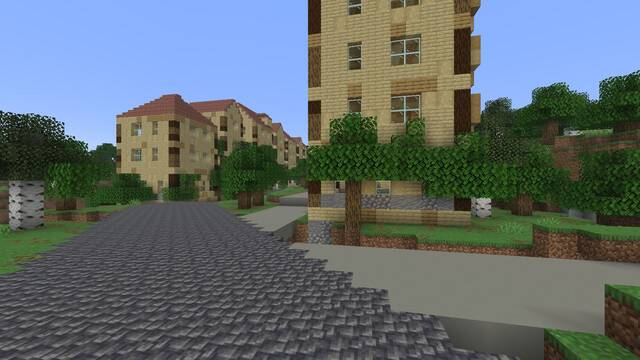

# Seed 3141592653589793238

fresh seed, not played before

Generated by `scripts/playtest-kit.sh` at commit `cca366564c` from an offline plan of this seed (terrain dump at 64-block
steps, the same columns the game's region layer reads, then `fractal-cli roads`). The game should agree; check with
`/fb locate` at spawn (table below). Distances and directions are from 0,0: your spawn point is usually within a few
hundred blocks of it (F3 shows where you are).

# World creation

1. Singleplayer, Create New World, game mode of your choice (Creative makes `/tp` and flying easy; allow commands).
2. More World Options: seed `3141592653589793238`, world type Default, Generate Structures ON.
3. Create. The first chunks around spawn can take a while.

# `/fb locate` at spawn should say

| Command | Settlement | Centre | Distance from 0,0 |
|---|---|---|---|
| `/fb locate hamlet` | sm1_0 (city, radius 704) | -384, 256 | 462 SW |
| `/fb locate village` | sm1_0 (city, radius 704) | -384, 256 | 462 SW |
| `/fb locate town` | sm1_0 (city, radius 704) | -384, 256 | 462 SW |
| `/fb locate city` | sm1_0 (city, radius 704) | -384, 256 | 462 SW |
| `/fb locate metropolis` | none within 8 cells |  |  |

`/fb locate` searches 8 region cells (about 8 km) around you and gives a settlement's centre; a different answer means the offline plan and the game disagree (worth an FBNOTE).

# Settlements within 4,096 blocks of 0,0



| # | Id | Tier | Centre x, z | Radius | Distance, direction | Biome mix (% of footprint) | Port | Road links | Teleport |
|---|---|---|---|---|---|---|---|---|---|
| 1 | sm1_0 | city | -384, 256 | 704 | 462 SW | temperate 43, taiga 27, mountain 14 | yes | 2 | `/tp @s -384 ~ 256` |
| 2 | sm1_m1 | village | -384, -576 | 130 | 692 NW | temperate 77, mountain 15, water 8 |  | 1 | `/tp @s -384 ~ -576` |
| 3 | s0_0 | hamlet | 384, 640 | 47 | 746 SE | temperate 100 |  | 2 | `/tp @s 384 ~ 640` |
| 4 | s1_m1 | hamlet | 1600, -256 | 50 | 1,620 E | temperate 100 |  |  | `/tp @s 1600 ~ -256` |
| 5 | s1_1 | town | 1536, 1280 | 316 | 1,999 SE | temperate 76, water 16 | yes | 1 | `/tp @s 1536 ~ 1280` |
| 6 | sm1_m3 | village | -512, -2752 | 82 | 2,799 N | temperate 100 |  | 1 | `/tp @s -512 ~ -2752` |
| 7 | sm2_m3 | village | -1600, -2560 | 96 | 3,019 NW | temperate 89, water 11 |  | 1 | `/tp @s -1600 ~ -2560` |
| 8 | s1_2 | hamlet | 1408, 2816 | 57 | 3,148 SE | temperate 100 |  |  | `/tp @s 1408 ~ 2816` |
| 9 | s2_m2 | village | 3072, -1344 | 99 | 3,353 NE | temperate 78, taiga 11, water 11 |  | 2 | `/tp @s 3072 ~ -1344` |
| 10 | sm3_1 | village | -2880, 1920 | 134 | 3,461 SW | temperate 85, mountain 8, water 8 |  | 1 | `/tp @s -2880 ~ 1920` |
| 11 | sm1_3 | hamlet | -640, 3520 | 77 | 3,578 S | temperate 60, snow 20, taiga 20 |  | 1 | `/tp @s -640 ~ 3520` |
| 12 | s1_m4 | village | 1408, -3392 | 123 | 3,673 NE | badlands 44, desert 44, water 11 |  |  | `/tp @s 1408 ~ -3392` |
| 13 | sm4_m1 | village | -3776, -320 | 219 | 3,790 W | temperate 92, mountain 5 |  | 1 | `/tp @s -3776 ~ -320` |
| 14 | s3_m2 | village | 3776, -1152 | 160 | 3,948 E | temperate 86, snow 14 |  | 1 | `/tp @s 3776 ~ -1152` |
| 15 | s3_1 | village | 3584, 1792 | 161 | 4,007 SE | temperate 91, water 10 |  | 1 | `/tp @s 3584 ~ 1792` |

The teleport keeps your height (`~`); in Survival use Creative or Spectator first, or replace `~` with a height. A long teleport
into unvisited land is held until the destination is generated (an action-bar message says so; up to 30 s).

# Road links to follow

Intercity roads leave a settlement at an exit and end at the other one's exit. Teleport to the start exit and walk.

| From | To | Road length | Start exit (x, z) | End exit (x, z) | Start here |
|---|---|---|---|---|---|
| sm1_0 (city) | sm1_m1 (village) | touching | -384, -447 | -384, -447 | `/tp @s -384 ~ -447` |
| sm1_0 (city) | s0_0 (hamlet) | touching | 294, 595 | 294, 595 | `/tp @s 294 ~ 595` |
| s0_0 (hamlet) | s1_1 (town) | 1,201 | 320, 768 | 1216, 1088 | `/tp @s 320 ~ 768` |
| sm1_m3 (village) | sm2_m3 (village) | 1,171 | -640, -2752 | -1472, -2432 | `/tp @s -640 ~ -2752` |
| s2_m2 (village) | s4_m3 (village) | 1,392 | 3200, -1472 | 4160, -2240 | `/tp @s 3200 ~ -1472` |
| s2_m2 (village) | s3_m2 (village) | 391 | 3200, -1280 | 3584, -1216 | `/tp @s 3200 ~ -1280` |
| sm3_1 (village) | sm4_1 (city) | touching | -3026, 1881 | -3026, 1881 | `/tp @s -3026 ~ 1881` |
| sm1_3 (hamlet) | sm1_4 (hamlet) | 1,019 | -768, 3584 | -896, 4416 | `/tp @s -768 ~ 3584` |
| sm4_m1 (village) | sm4_1 (city) | 906 | -3776, -64 | -3840, 768 | `/tp @s -3776 ~ -64` |
| s3_1 (village) | s4_2 (hamlet) | 959 | 3776, 1920 | 4480, 2176 | `/tp @s 3776 ~ 1920` |

# A short route for the first hour

Walking is about 4.3 blocks a second (sprint 5.6), so 1,000 blocks is about 4 minutes.

1. walk from spawn to sm1_0 (city, centre -384, 256): about 462 blocks.
2. walk across (the two touch) to s0_0 (hamlet, centre 384, 640): about 859 blocks.
3. follow the road to s1_1 (town, centre 1536, 1280): about 1,201 blocks; road starts at 320, 768.

In each: walk the main street to the centre, go into a few buildings (upstairs too), sleep in a bed, open a chest.

# Fly-through frames

Shot by `scripts/flythrough.sh` (commit `6ea46a6708`), downscaled. The teleport puts you where the camera stood.



metropolis s5_2 (centre 5952,2240), sweep-a: `/tp @s 6041.3 122.8 2140.6 -157.5 24.0`



city sm1_0 (centre -384,256), sweep-a: `/tp @s -511.9 110.3 356.2 112.5 24.0`



town s1_1 (centre 1536,1280), view: `/tp @s 1483.3 123.2 1493.1 -157.5 24.0`



village sm1_m1 (centre -384,-576), view: `/tp @s -358.0 133.7 -539.1 -157.5 24.0`



metropolis s5_2 (centre 5952,2240), street: `/tp @s 6208.5 81.4 1888.5 -180.0 -0.1`



city sm1_0 (centre -384,256), street: `/tp @s -503.5 72.4 456.5 -12.2 -0.1`

# Offline road report

```
seed 3141592653589793238: 43 settlements {city=5, hamlet=14, town=7, village=17}, 12 tagged port
linked 32 of 43 = 74.4 %; unlinked: 2 with no neighbour within 1536, 9 with every neighbour unroutable, 0 with a routable neighbour (must be 0)
links: 19 routed + 6 meeting points (touching), 20 pairs dropped by the dry check or no path {dry check failed after N reroutes: wet run N=3, dry check failed, nothing left to ban: wet run N=1, no dry reroute=7, no path=6, no port=3}
centre-to-centre per 500: 500: 2, 1000: 11, 1500: 6
route length mean / p50 / p95 / max: 1108.2 / 1085.0 / 2184.0 / 2184.0
max deck grade per route mean / p50 / p95 / max: 0.2 / 0.3 / 0.4 / 0.4
crossings: 11 on 9 of 19 routes; wet run length per 4: 0: 7, 4: 2, 8: 1, 20: 1; 8 routes rerouted; 68919 road columns
exact station reads per route mean / p50 / p95 / max: 540.3 / 356.0 / 1942.0 / 1942.0
lattice node requests per route mean / p50 / p95 / max: 1567.1 / 936.0 / 7512.0 / 7512.0
route time ms mean / p50 / p95 / max: 40.2 / 17.5 / 410.2 / 410.2
lattice nodes read from the coarse probe: 6194; routes built: 48 (incl. witnesses and dropped); all of it in 1.2 s
```
